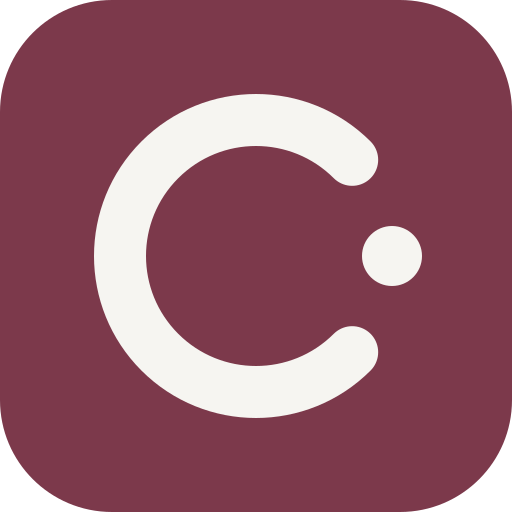

# Cadence

**A calm place for your time.** A local planner for work, study, and everyday life.

<br clear="left">

Cadence is being designed around **Today, Week, and Tasks**. See the next commitment, find time for work and keep deadlines clear. A task says what needs to be finished; a plan reserves time to do it. The planned local product needs no account or school identity.

**Current status:** the learning app supports task input, validation, addition, completion, deletion, undo of the latest deletion, and task-title copying with visible feedback. Data stays in memory. Persistence and the full planner are not implemented. The [learning log](docs/LEARNING.md) owns current lesson progress, automated results and pending actual-window checks. Design documents and successful builds do not establish release readiness.

[Website source](website/README.md) · [Product](docs/PRODUCT.md) · [UI preview](assets/ui/planner-study.html) · [Setup](docs/SETUP.md) · [Documentation](docs/README.md)

For the next steps, use the [numbered lesson plan](docs/CURRICULUM.md#numbered-lesson-plan). It lists what the learner writes in each lesson and what the assistant supports. The plan does not mark future features or lessons complete.

## Product direction

| Destination | Question it answers | Planned behavior |
|---|---|---|
| Today | What needs attention now? | Current or next commitment, daily agenda and due tasks |
| Week | When can I make time? | Commitments, free intervals and explicit plan entry |
| Tasks | What needs to be finished? | Quick capture, editing, deadlines and completion |

The first useful product includes direct task, plan and timetable editing, bounded repeats, single-occurrence corrections, local saving and safe recovery. First use will offer **Save on this device** or **Temporary use**. Japanese, English and Chinese, keyboard access and readable compact layouts are planned throughout. These flows still need implementation and acceptance. See [scope and priorities](docs/PRODUCT.md) and the [product design](docs/REDESIGN.md).

Build the ad-free Android self-use edition first under [ADR-015](docs/adr/015-android-self-use-first.md), using Windows as the development host. Start with safe shared tasks and recovery, then direct plans, Today and Week, then a task-linked countdown with manual breaks and local records. Test each slice on the phone. The [bounded desktop candidate](docs/DESKTOP_V1.md), music integration and Steam work are later choices. No external trial cohort or complete Windows release is needed to continue self-use; public distribution has its own gates. The [roadmap](docs/ROADMAP.md) owns order, checks and provisional estimates.

Screenshot recognition, CSV/table import and all school-access work are deferred. A local release does not need school permission. No application, permission, connection or automatic school update is confirmed. Cloud sync needs a separate later review. Desktop, Web and the website remain ad-free; only mobile ads may be tested after a useful mobile release. The [product scope](docs/PRODUCT.md#optional-later-work) keeps these extensions separate from current delivery.

The self-use edition has no ads and assumes no income. A later one-time desktop purchase and mobile-only ad pilot remain hypotheses, not approved prices or guaranteed revenue. No subscription, paid priority or ad-based feature unlock is planned. The repository became public again on 2026-11-27 under ADR-016, and the concept site returned on GitHub Pages. LICENSE remains MIT. [AGENTS.md](AGENTS.md) records these limits.

## Review the product and UI

Start with the [product design](docs/REDESIGN.md), then compare the [local planner preview](assets/ui/planner-study.html) with its [review guide](assets/ui/PLANNER_STUDY.md). The preview uses fictional data to study Today, Week, Tasks and editing. It is design documentation, not a working Flutter planner or a second hosted site.

The [design system](docs/DESIGN.md) owns visual rules. [UI architecture](docs/UI_ARCHITECTURE.md) owns navigation and interaction. The [documentation index](docs/README.md#document-ownership) identifies the source for each topic. The small [timetable survey](docs/SURVEY_FINDINGS.md) informs hypotheses; it does not prove broad planner demand or repeat use.

## Learn by building

The learner writes the core code for each small lesson, including representative Dart logic and Flutter widgets, state, layout and lifecycle work. The assistant completes repeated supporting code, visual polish, broader tests, documentation, artwork and the website. The [division of work](docs/CURRICULUM.md#division-of-work) keeps practice focused while the learner learns to trace and explain the complete result. lib/main.dart remains the teaching entry.

Start with [current progress and the next step](docs/LEARNING.md). The [curriculum](docs/CURRICULUM.md) owns the learning sequence and evidence of understanding. Passing application tests does not by itself show that the learner can explain or adapt the code. Lesson counts are not release promises.

All repository documentation uses plain English. This rule also applies to future updates; see [AGENTS.md](AGENTS.md). Product translations remain separate.

## Run the current app

Use Flutter **3.44.4** / Dart **3.12.2**, matching CI.

```sh
flutter pub get
flutter run -d windows
```

Use the matching Linux/macOS target on a configured host. [Setup](docs/SETUP.md) lists the required tools and checks. There is no implemented Web planner in this checkout.

The product UI uses Flutter shadcn_ui, introduced one used control at a time. [pubspec.yaml](pubspec.yaml) and its lockfile record installed dependencies. Add storage packages when the learner reaches local saving; do not install future services to run the current app.

## Artwork and website

The quiet journal style uses pure white, muted wine and graphite. Paper and sage stay inside the original color artwork. Preserve the independent C mark and website source. The concept site is served from GitHub Pages; other server deployment is deferred.

The catalogue groups artwork by use and offers search, filters, size samples and downloads. The [artwork guide](assets/README.md) owns source/export rules and browser-check records.

[Visual overview](assets/preview.png) · [Full contact sheet](assets/preview-library.png) · [Catalogue](assets/catalog.html) · [Artwork guide](assets/README.md) · [Design system](docs/DESIGN.md)

The Japanese/English/Chinese website shows fictional concepts. It is not a working planner or a download page. Since 2026-11-27 the site is served again by GitHub Pages at https://lorendw7.github.io/Cadence/. The Pages workflow publishes only the website directory.

## Repository

| Path | Purpose |
|---|---|
| lib/ and test/ | Learning app and active tests |
| docs/ | Product, architecture, learning, and release guides |
| lessons/ | Historical exercise templates |
| assets/ | Artwork sources, exports and local UI studies |
| website/ | Static concept website |
| tools/ | Generators and read-only checks |
| windows/, linux/, macos/ | Desktop runners |
| android/ | Runner for the first self-use target. A debug APK built on 2026-11-15; phone testing and release acceptance are still pending |
| .github/workflows/ | Checks, Android debug APK and desktop builds, and the disabled Pages workflow |

See [the repository map](docs/REPOSITORY.md) and [maintenance tools](tools/README.md).

## Checks

```sh
node tools/check_repository.cjs
node tools/check_website.cjs
python tools/check_artwork.py
dart format --output=none --set-exit-if-changed lib test
flutter analyze --fatal-infos --fatal-warnings
flutter test
```

## License

[MIT](LICENSE) © 2026 lorendw7
