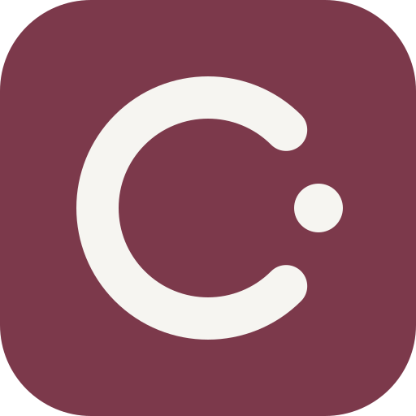

# Cadence

**A calm place for your time.** A local planner for work, study, and everyday life.

<br clear="left">

Cadence is being designed around three views: **Today, Week, and Tasks**. The desktop app should work offline without an account. At first use, people will choose whether to save on their device or use a temporary session. School connections, including Kyushu University, are optional extensions.

**Current status:** the learning app supports task input, validation, addition, completion, deletion, and undo of the latest deletion. Data stays in memory. Lessons 1–10 are accepted. Lesson 11's shared paper-and-wine theme and lesson 12's shadcn_ui root integration pass analysis and all 26 tests. The practice increment action is the first migrated ShadButton. Actual-window theme and keyboard confirmation remain pending. Persistence and the full planner are not implemented. See [learning progress](docs/LEARNING.md) for automated and manual checks.

[Website](https://lorendw7.github.io/Cadence/) · [Product](docs/PRODUCT.md) · [Design](docs/REDESIGN.md) · [Roadmap](docs/ROADMAP.md) · [Setup](docs/SETUP.md) · [Documentation](docs/README.md)

## Product direction

- Plan appointments, focused work, study, and personal time together.
- Keep tasks and bounded repeating plans easy to create, edit, and complete.
- Use Windows, Linux, or macOS without a required account or server.
- Make local saving, temporary use, backup, recovery, and deletion clear.
- Support Japanese, English, and Chinese, keyboard use, and readable layouts.

These are design goals. The first useful release should prove a small local planning flow before adding advanced features. Course rules and school imports belong to an optional education extension. Web and synchronization are considered only when a school connection needs them. There is no general Web or personal cloud-sync delivery track.

General product releases do not depend on a school. Any school connection needs permission for that specific interface and data. Cadence is independent and has no university endorsement. The current direction is recorded in [ADR-007](docs/adr/007-general-purpose-local-planner.md).

## Learn by building

The learner writes core application features. The assistant explains, reviews, prepares useful tests, and maintains delegated documents, artwork, and the website. Work advances one small lesson at a time; lib/main.dart remains the teaching entry.

Start with [the learning guide](docs/LEARNING.md) and [curriculum](docs/CURRICULUM.md). Earlier course-heavy estimates are being separated into core and optional work. Lesson counts are estimates, not release promises.

All repository documentation uses plain English. This rule also applies to future updates; see [AGENTS.md](AGENTS.md). Product translations remain separate.

## Run the current app

Use Flutter **3.44.4** / Dart **3.12.2**, matching CI.

```sh
flutter pub get
flutter run -d windows
```

Use the matching Linux/macOS target on a configured host. [Setup](docs/SETUP.md) lists the required tools and checks. There is no implemented Web planner in this checkout.

The product UI uses Flutter shadcn_ui, introduced one used control at a time. Introduce drift with local saving; add another package only for a demonstrated need. [ADR-008](docs/adr/008-small-free-local-product.md) records the smaller design, including explicit Save, memory-only unsaved forms and ordinary local storage. [pubspec.yaml](pubspec.yaml) and its lockfile record installed dependencies. The starter version is not a production-readiness claim.

## Artwork and website

The quiet journal style uses warm paper, muted wine, sage, and graphite. The v2 library has 56 interface icons, 10 state illustrations, an editorial image, patterns, platform icons, and a sharing card. Responsive WebP exports reduce website image size while preserving the original artwork.

[Visual overview](assets/preview.png) · [Catalogue](assets/catalog.html) · [Artwork guide](assets/README.md) · [Design system](docs/DESIGN.md)

The Japanese/English/Chinese website shows fictional concepts. It is not a working planner or a download page. GitHub Pages publishes only the website directory.

## Repository

| Path | Purpose |
|---|---|
| lib/ and test/ | Learning app and active tests |
| docs/ | Product, architecture, learning, and release guides |
| lessons/ | Historical exercise templates |
| assets/ | Artwork sources and exports |
| website/ | Static concept website |
| tools/ | Generators and read-only checks |
| windows/, linux/, macos/ | Desktop runners |
| android/ | Legacy scaffolding; no mobile product plan |
| .github/workflows/ | Checks, desktop builds, and website delivery |

See [the repository map](docs/REPOSITORY.md) and [maintenance tools](tools/README.md).

## Checks

```sh
node tools/check_repository.cjs
node tools/check_website.cjs
python tools/check_artwork.py
dart format --output=none --set-exit-if-changed lib test
flutter analyze --fatal-infos --fatal-warnings
flutter test
```

## License

[MIT](LICENSE) © 2026 lorendw7
