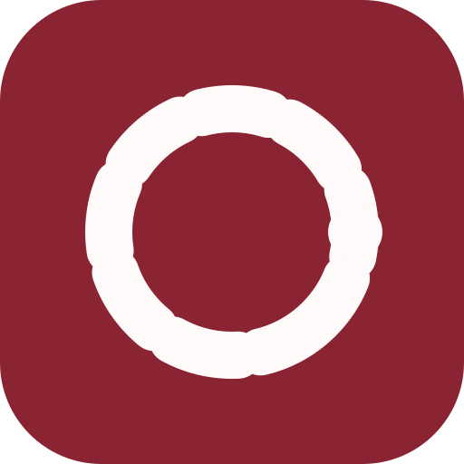

# Cadence

**A calm place for your time.** A time planner primarily for students, also suitable for teachers and other people organizing study, work and personal life. Courses are one kind of schedule entry; no school identity is required.

<br clear="left">

**Development status:** lessons 1–8 and the title-validation portion of lesson 9 have passed automated acceptance, with all 19 tests passing. The application supports title input, adding tasks, completion/undo and correctable blank-title errors; successful additions trim the title and clear the input. The learner confirmed continuous addition, input clearing and new-task toggling in the actual window. Lesson 9's empty-list message is next; manual title-validation confirmation is pending. Data remains in memory. Deletion, course management, persistence, the selected UI system and the Web application are not implemented. The website shows concepts, not a functional planning MVP.

**Selected direction:** Windows, Linux, macOS and Web, using Flutter's **shadcn_ui** package in an independent academic-journal style. The package is selected but has not been introduced. No Android/iOS product is planned; Android is legacy scaffolding. Web is a confirmed development target, with its own storage, security and delivery acceptance.

Cadence is independent. It does not copy Kyushu University's official identity or imply endorsement. Future school demonstrations may invite feedback; school authentication and timetable-data access are optional integrations requiring separate authorization. Manual planning requires neither.

[Product design / 产品设计](docs/REDESIGN.md) · [Roadmap](docs/ROADMAP.md) · [UI design](docs/UI_ARCHITECTURE.md) · [Data protection](docs/SECURITY.md) · [Future school demo](docs/SCHOOL_DEMO.md) · [Setup](docs/SETUP.md) · [Documentation](docs/README.md) · [Website](https://lorendw7.github.io/Cadence/)

## Planned product

- Courses and personal arrangements together in Today and week views.
- Manual creation, editing and deletion, bounded weekly repeats, tasks and completion.
- Japanese, English and Chinese, keyboard access and readable desktop/browser layouts.
- Desktop local persistence with tested recovery; a browser-local Web version with memory mode and explicit saving choices.
- Strict JSON import with preview and confirmation before replacement, private export and clear data controls.
- Later desktop lessons add teaching weeks, single-class changes, filtered timetable sharing, CSV/paste, local review and tested reminders.

The planned initial Web scope has no backend, account, school API, cloud synchronization, CSV, notifications or single-occurrence class changes. Private JSON exports are not a filtered course-sharing format. Browser storage is neither encrypted nor a durable backup. These are designs, not available features; [PRODUCT.md](docs/PRODUCT.md) defines the stage boundaries.

## Learn by building

The learner writes application feature code. The assistant explains, reviews, prepares appropriate tests/templates and maintains delegated documentation and the website. **The assistant does not implement the core application on the learner's behalf.** Keep `lib/main.dart` as the teaching entry and advance one small lesson at a time.

The [curriculum](docs/CURRICULUM.md) estimates 64 lessons for a limited Windows pilot and 80–100 for broader desktop validation. A basic browser-local Web version provisionally adds 8–16 lessons after reusable desktop behavior exists, giving about 88–116 overall. These are teaching estimates counted from lesson 1, not completion promises; backend work and school integration are excluded.

## Run the current learning application

Use Flutter **3.44.4** / Dart **3.12.2**, matching the metadata and CI.

```sh
flutter pub get
flutter run -d windows
```

Use a corresponding Linux/macOS target on a configured host. Web setup will be added by the learner when that stage begins; current setup is in [SETUP.md](docs/SETUP.md).

## Repository layout

| Path | Purpose |
|------|---------|
| `lib/main.dart` | Current teaching application entry |
| `lib/domain/coursework/` | Learner's task-model exercises |
| `test/` | Active tests; pending lesson templates remain separate |
| `windows/`, `linux/`, `macos/` | Native desktop runners |
| `android/` | Legacy scaffolding, no mobile product commitment |
| `assets/brand/` | Independent project artwork |
| `docs/` | Product, security, architecture, learning and release plans |
| `website/` | Japanese/English/Chinese concept website |
| `.github/workflows/` | App checks, builds and website deployment |

## Development

```sh
dart format lib test
flutter analyze --fatal-infos --fatal-warnings
flutter test
```

The selected product UI package is [shadcn_ui](https://pub.dev/packages/shadcn_ui), not `shadcn_flutter` or React shadcn/ui. It is not installed yet. [pubspec.yaml](pubspec.yaml) and its lockfile remain the installed-dependency source of truth. Introduce shadcn_ui, Riverpod and drift only during their implementation lessons. The starter version `1.0.0+1` is not a production-readiness claim.

## License

[MIT](LICENSE) © 2026 lorendw7
