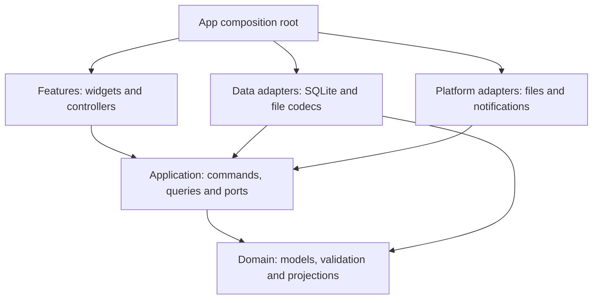

# Architecture

Updated: 2026-11-09. Status: **target architecture, not implemented**. The current executable is the small Today placeholder in `lib/main.dart`. The learner's task-model exercise is separate from the persistence design below. [REDESIGN.md](REDESIGN.md) defines behavior; [LEARNING.md](LEARNING.md) defines teaching order.

## Layers

Arrows mean **imports / depends on**, not write order. `app/` constructs concrete adapters and injects them through application-owned ports.



| Boundary | Responsibility | Excluded dependencies |
|----------|----------------|-----------------------|
| `features/` | Rendering, form input, loading/error/pending state | SQL, file codecs, recurrence logic, notification plugins |
| `application/` | Use cases, repository/clock/platform ports, transaction and refresh coordination | Flutter, drift-generated rows, plugin types |
| `domain/` | Plain Dart models, weeks, occurrences, task groups, conflicts and aggregates | I/O, system time, provider/widget state |
| `data/` | Port implementations, migrations, transactions and validated file formats | Page navigation or a second copy of domain rules |
| `platform/` | Native file dialogs, lifecycle and notification capabilities | Ownership of canonical course/task data |
| `app/` | Startup, wiring, routing and themes | Shared business logic |

Features communicate through application queries/commands, not each other's controllers. Ports expose domain values and typed outcomes; database rows and file/plugin DTOs are mapped inside adapters. Add concrete operations for use cases instead of a generic CRUD framework. See [ADR-001](adr/001-local-application-boundaries.md) for the decision and alternatives, and [APPLICATION.md](APPLICATION.md) for transaction, query and recovery contracts.

Widgets do not read SQL or parse import files. Domain functions do not depend on Flutter widgets, the database or system time. Inject a clock for Today and overdue calculations. Repositories expose streams; application use cases group related mutations into transactions.

Begin with plain Dart models and Flutter's built-in local widget state. Introduce Riverpod when multiple screens share state and drift/SQLite when implementing persistence. Current installed dependencies remain in `pubspec.yaml`. Add platform packages only after checking Windows, Linux and macOS support. Weekly review uses pure Dart calculations and basic Flutter bars/text initially; no chart service or chart package is required. See [LEARNING.md](LEARNING.md) and [STATISTICS.md](STATISTICS.md).

## Source organization

Create modules when code is introduced, not as empty scaffolding.

```text
lib/
  main.dart
  app/                   # startup, routing, responsive shell, themes
  domain/
    semesters/           # week calculation and period rules
    scheduling/          # occurrences, exceptions, timezone policy, conflicts
    coursework/          # deadlines and completion
    statistics/          # bounded interval aggregates, no UI or network
  application/
    ports/               # storage, clock, timezone, files, notifications
    coursework/          # task commands and Today query
    scheduling/          # schedule query and preview/commit commands
    editing/             # ordered draft saves and promotion
    transfer/            # import, export and restore coordination
    reminders/           # desired-state reconciliation
  data/
    database/            # tables, migrations, transactions
    repositories/
    transfer/            # versioned timetable and full-backup formats
  features/
    today/
    week/
    courses/
    tasks/
    review/              # secondary screen entered from Week
    settings/
  platform/              # file dialogs and desktop integration
  l10n/
test/                    # mirror domain/data/features modules
integration_test/        # add with persisted user flows
```

No authentication layer, API adapters or synchronization engine are planned.

| First working slice | Boundary introduced | Exit condition |
|---------------------|---------------------|----------------|
| Task model and in-memory list | Plain model and widget-local state | Add/complete/undo; disclose that closing loses data |
| Saved tasks and drafts | Application command, storage port, SQLite adapter | Restart preserves confirmed data; failures retain input |
| Today and personal plans | Injected clock and bounded queries | Midnight, deadline and resume refresh; counts equal lists |
| Courses and single changes | Shared occurrence projection | Move across weeks, cancel and restore without duplicates |
| Review, files and reminders | Consumers and dedicated adapters | Consistent results, privacy, rollback and native failure checks |

These are incremental boundaries, not prerequisites for the current task-model lesson. Do not create empty modules, install unused dependencies or introduce an event bus/persistent occurrence cache.

## Schedule projection

Keep course rules and repeating personal plans as canonical records. Derive occurrence lists for bounded queries. An occurrence identity uses its rule ID and original scheduled date; a move changes its displayed time, not its identity.

Query both base occurrences overlapping the requested window (including overnight starts before it) and overrides moved into the window from elsewhere. Load referenced rules even when their original semester is outside the window. Apply overrides before filtering final intervals and deduplicate by source kind, rule/plan ID and original date. Use the same projection for Today, week rendering, conflicts, review and visual timetable previews. Each consumer supplies an explicit range and scope; notification scope is independent of screen filters.

Read related tables from one consistent database snapshot. Recombining independent table streams can briefly pair a new rule with old exceptions. Query results carry the range, timezone, scope and formal-data generation; controllers discard results from superseded requests. Detailed contracts are in [APPLICATION.md](APPLICATION.md).

Course periods resolve against their semester's period table. Personal plans have explicit start/end values and do not depend on the selected semester. Display all time-based occurrences in the selected display timezone; preserve original timezone metadata.

Editing an entire rule or semester configuration first produces a change preview, including orphaned exceptions and affected plans. Apply the user's chosen resolution atomically.

## Time boundaries

Use calendar dates for semester anchors, selected teaching weeks, exception identity and all-day ranges. Use timezone-aware wall times for timed rules, deriving instants for overlap and cross-zone display. Do not advance teaching weeks by adding a fixed number of seconds across daylight-saving transitions.

All-day end dates and timed interval ends are exclusive. Same-day deadlines without a time become overdue on the next local date. Ambiguous/nonexistent local times require explicit handling before storage. Keep timezone conversion and recurrence expansion behind one tested module.

## Files and data safety

Timetable export is an allowlisted projection of canonical rules, not a database dump or a serialized week of occurrences. Its content preview comes from the exact payload to be written; its visual schedule preview may use the shared projector. Full backup is a separate versioned format. Validate size, schema version, references and business constraints before opening a write transaction. Future unsupported versions must fail with an actionable message.

Imports remap IDs and store provenance for duplicate detection. Duplicate names are allowed; duplicate imported identities are handled explicitly. Restore takes a backup and validates in staging before replacing data. Never overwrite a live SQLite file from an arbitrary copied file or a cloud-sync folder.

## Platform boundary

Keep standard Flutter platform folders. Test file dialogs, paths, keyboard input, scaling and persistence on each desktop host. CI debug builds prove compilation, not runtime behavior or signing. Running-process system notifications are planned behind a mockable platform adapter; see [NOTIFICATIONS.md](NOTIFICATIONS.md). Background/closed-process behavior is a separate acceptance stage. Draft persistence and revision ordering follow [EDITING.md](EDITING.md).

For data structures see [DATABASE.md](DATABASE.md), for validation [QUALITY.md](QUALITY.md), and for delivery [RELEASE.md](RELEASE.md).
