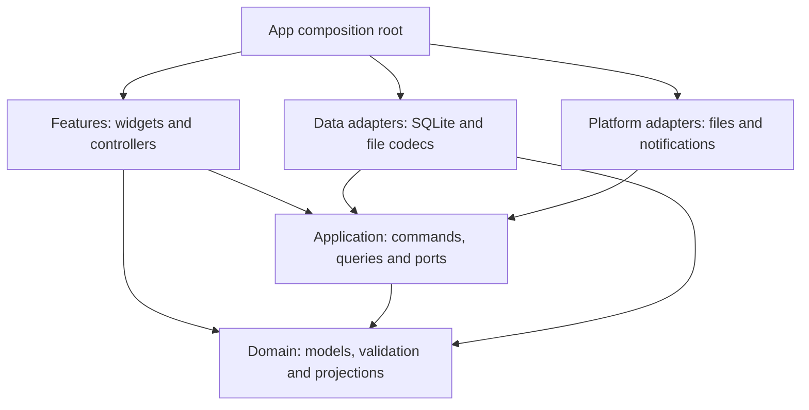

# Architecture

Latest refinement: [ADR-005](adr/005-local-offline-and-school-gated-web.md) makes desktop primary and Web deployment conditional on school permission. It recommends IndexedDB instead of the earlier localStorage snapshot candidate, separates local retention from school connectivity, and specifies offline resources and deletion coordination. None of this is implemented.

Updated: 2026-11-10. Status: **target architecture, not implemented**. Cadence is a planner primarily for students and also suitable for teachers and other users. Windows/Linux/macOS and Web are confirmed targets; mobile apps are excluded. The current executable displays Today and two read-only sample tasks in `lib/main.dart`, using the learner's task model. Lesson 4 adds an in-memory practice counter with increment/reset buttons; all 10 tests pass and the learner confirmed hot-reload/restart behavior. Task mutation and persistence are still unimplemented. The selected Flutter shadcn_ui package is not introduced yet; the learner implements core features through lessons. The assistant handles delegated docs/website work, explanation, review and appropriate tests/templates. [ADR-004](adr/004-shadcn-web-direction.md) records the current direction.

Manual planning and local import require no account or server. Authorized university authentication and read-only timetable access are conditional future capabilities, not prerequisites for the local core. No school approval or usable timetable API has been established. See [ADR-004](adr/004-shadcn-web-direction.md) and [university integration](UNIVERSITY_INTEGRATION.md) for the product boundary and unresolved dependencies.

## Selected structure and when it grows

Use **one modular client**: one application package, with explicit internal responsibilities and one canonical store per user data directory. Each supported OS gets a build of the same product. Modules are code boundaries, not separately deployed services or independent databases. A broader student/teacher audience does not require a central backend when each user plans locally. [ADR-003](adr/003-incremental-modular-client.md) records this choice and its trade-offs.

This uses the separation of responsibilities and one-way data flow described in Flutter's [architecture guide](https://docs.flutter.dev/app-architecture/guide) and [recommendations](https://docs.flutter.dev/app-architecture/recommendations). The exact modules and introduction triggers below are Cadence decisions; those guides are not a requirement to create every layer for a small task screen. Keep the repository's pinned SDK and evaluate new packages only when their working stage begins.

Build a complete small user flow before introducing the next boundary. A working feature includes its relevant failure behavior, not only the happy-path screen. These are implementation triggers, not extra prerequisites for the current lesson:

| Working stage | Introduce because it is needed | Keep deferred | Observable exit |
|---------------|-------------------------------|---------------|-----------------|
| Model and one in-memory task screen | Plain Dart task values; feature widgets; screen-local `setState` | Application ports, database, Riverpod, generic controllers | Add/complete/undo works; closing loses data and the screen says so |
| First persisted task flow | One task query/command boundary, a small storage port, drift/SQLite adapter, startup wiring and truthful save state | Course tables, recurrence, import and remote interfaces | Restart preserves confirmed tasks; a failed save preserves input and reports failure |
| Shared async views and recoverable editing | Shared query owner, Riverpod wiring when justified, editor-session drafts and revision checks | Global event bus, duplicated page-owned task lists, all future screens | Editing once updates every active consumer; stale results and queued draft writes cannot undo newer work |
| Courses and multiple schedule consumers | Semester/rule models, one bounded occurrence projector, consistent schedule snapshots and preview/commit | Stored occurrence cache, advanced sync engine | Today, Week and conflicts agree on a moved or cancelled class |
| Files, review and reminders | Dedicated consumers/adapters around existing saved data and projection | New copies of scheduling rules, speculative platform packages | Private data stays out of sharing; failed import rolls back; reminder failure does not undo a saved schedule |
| Web implementation stage | Browser-local adapter, explicit save choice, strict JSON and deployment behavior | Accounts, backend, school API, speculative platform parity | Browser storage/failure/clearing and actual deployment accepted |
| Approved school source, if pursued | Only adapters justified by an authorized data contract | Guessed APIs or credential collection | Permission and source-data security gates pass |

Choose Riverpod for shared asynchronous view state and dependency wiring when multiple consumers or replaceable I/O make ownership difficult. A single screen's open panel, text input or selected tab still belongs in local widget state; neither persistence nor the mere existence of folders forces a new state-management package. drift is the planned desktop persistence adapter, introduced with the first saved flow. `pubspec.yaml` remains the source of truth for installed dependencies.

The interface uses shared application presentation components without importing platform services into domain rules. Component/library choices and desktop interaction rules are in [UI_ARCHITECTURE.md](UI_ARCHITECTURE.md). Work items, review and acceptance follow [PROJECT_WORKFLOW.md](PROJECT_WORKFLOW.md); the learner continues through [LEARNING.md](LEARNING.md) one small exercise at a time.

## Dependencies after persistence is introduced

Arrows mean **imports / depends on**, not write order. This is the target for persisted/shared features, not the initial in-memory lesson. `app/` constructs concrete adapters and injects them through application-owned ports. Plain domain values may be used directly by a feature.



| Boundary | Responsibility | Excluded dependencies |
|----------|----------------|-----------------------|
| `features/` | Rendering, form input, loading/error/pending state | SQL, file codecs, recurrence logic, notification plugins |
| `application/` | Use cases, repository/clock/platform ports, transaction and refresh coordination | Flutter, drift-generated rows, plugin types |
| `domain/` | Plain Dart models, weeks, occurrences, task groups, conflicts and aggregates | I/O, system time, provider/widget state |
| `data/` | Port implementations, migrations, transactions and validated file formats | Page navigation or a second copy of domain rules |
| `platform/` | Native file dialogs, lifecycle and notification capabilities | Ownership of canonical course/task data |
| `app/` | Startup, wiring, routing and themes | Shared business logic |

Persisted features communicate through application queries/commands, not each other's controllers. Ports expose domain values and typed outcomes; database rows and file/plugin DTOs are mapped inside adapters. Add concrete operations such as saving a task or previewing a course change instead of a generic CRUD framework. A trivial pure model operation does not need a separate use-case class. See [ADR-001](adr/001-local-application-boundaries.md) for the decision and alternatives, and [APPLICATION.md](APPLICATION.md) for transaction, query and recovery contracts.

Widgets do not read SQL or parse import files. Domain functions do not depend on Flutter widgets, the database or system time. Inject a clock for Today and overdue calculations. Storage queries may return a snapshot or a stream according to the consumer; do not require every query to be reactive. Application use cases group related mutations into transactions.

Evaluate platform packages against Windows, Linux and macOS; verify browser support during the confirmed Web stage. An unavailable capability needs a documented fallback or a narrower release claim. Weekly review uses pure Dart calculations and basic Flutter bars/text initially; no chart service or chart package is required. See [STATISTICS.md](STATISTICS.md).

## State ownership and mutation flow

For the later optional sync service, see [ADR-006](adr/006-optional-multi-client-sync.md) and [SYNC.md](SYNC.md). The proposed architecture adds a single HTTPS API and PostgreSQL, with local transactional outboxes, server versions and committed change cursors. Local revisions remain local; school refresh remains a separate reviewed source flow. This does not add a backend to the current lessons or authorize deployment.

Security implementation candidates are in [DATA_PROTECTION.md](DATA_PROTECTION.md): encrypted native storage and platform key management belong behind infrastructure adapters; domain rules stay independent. Do not install these packages during the current task-list lesson. Treat encryption, input validation and access authorization as developer responsibilities rather than user-controlled safety switches.

| State | Owner | Rule |
|-------|-------|------|
| Confirmed tasks, courses and personal plans | Local persistence adapter behind application operations | One canonical saved representation; no second mutable list in another page |
| Model/list lesson before persistence | The single task-screen state | Temporary ownership only; explicit data-loss notice and no claimed durability |
| Editor input and recoverable drafts | One editor session and its draft coordinator | Unsaved input is not a confirmed course; sequence saves and retain input on failure |
| Loading, pending write, failure and last loaded data | Feature controller/shared query owner | Acknowledged persistence determines saved status; stale requests cannot replace newer ones |
| Selection, focus, expansion and open dialogs | The nearest relevant widget or page | Keep transient UI state out of the database unless it is an explicit user preference |
| Teaching weeks, occurrences, conflicts and review totals | Pure functions over an identified saved snapshot | Derived values are not another editable data store |
| Reminder dispatch state | Reminder adapter/coordinator | OS delivery status is separate from schedule persistence |

For a saved edit: the feature captures input → an application operation validates and commits through the writer → the storage/query owner publishes confirmed data → consumers render it. A controller must not both append an optimistic item and append the same item again when a database stream arrives. The first persisted flow uses confirmed writes and visible pending state; optimistic interactions require a separately specified rollback/reconciliation behavior if later justified. Failure keeps the editor open and does not falsely announce a successful save.

Today counts, task lists and reminder decisions must derive from the same saved interpretation. Multiple views may cache read-only snapshots with request identities; none may become an independent source of task completion or course truth.

## Source organization

Group UI widgets and their controllers by feature; group reusable domain/application operations by the same capability. A task feature never calls a Week controller, and a storage adapter never imports a feature. Share reusable presentation components through the UI layer described in [UI_ARCHITECTURE.md](UI_ARCHITECTURE.md), while shared scheduling rules stay in `domain/`.

Create files when their first implementation is introduced. The current learning code needs only `main.dart` and `domain/coursework/planner_task.dart`; no alternate implementation is created for the learner. The first list can add `features/tasks/`; the first persisted task slice adds only its used `application/coursework/` operations/port, `data/` adapter and `app/` wiring. Do not create the complete tree below at once.

```text
lib/
  main.dart
  app/                   # startup, routing, responsive shell, themes
  domain/
    semesters/           # week calculation and period rules
    scheduling/          # occurrences, exceptions, timezone policy, conflicts
    coursework/          # deadlines and completion
    statistics/          # bounded interval aggregates, no UI or network
  application/
    ports/               # shared ports only; feature-specific ports stay with capability
    coursework/          # task commands and Today query
    scheduling/          # schedule query and preview/commit commands
    editing/             # ordered draft saves and promotion
    transfer/            # import, export and restore coordination
    reminders/           # desired-state reconciliation
  data/
    database/            # tables, migrations, transactions
    repositories/
    transfer/            # versioned timetable and full-backup formats
  features/
    today/
    week/
    courses/
    tasks/
    review/              # secondary screen entered from Week
    settings/
  platform/              # files, lifecycle and platform capabilities
  l10n/
test/                    # mirror domain/data/features modules
integration_test/        # add with persisted user flows
```

This is a navigation map for the eventual local features, not a checklist of required folders. Keep interfaces near their consuming capability; promote one to `application/ports/` only when multiple capabilities share it. A single generic `utils/`, service locator, base repository or inheritance-heavy controller framework must not become a substitute for named responsibility. Avoid one class/file per trivial operation, a multi-package workspace, event sourcing, an event bus or persisted occurrence caches until a concrete measured need justifies the cost.

Future approved identity and timetable-source adapters belong behind application-owned ports, outside the domain. Define their concrete interfaces only after the supported protocol and data contract are known. Do not add empty authentication modules, a speculative backend or a general synchronization engine to the current exercise.

## Optional university integration

University login proves identity; it does not grant timetable-data access. Treat authentication and read authorization as separate capabilities, with separate school decisions. A school-approved flow must keep password entry on the approved authentication surface; Cadence must not collect or persist university passwords. Do not substitute simulated login or unapproved scraping if an official interface is unavailable.

An approved timetable-source adapter retrieves a bounded, read-only source snapshot and maps it into import candidates. Application use cases validate semester/period mappings, compare provenance and show a change preview before committing through the existing local writer. Source responses cannot mutate SQLite or screen state directly. Keep local edits and personal arrangements independent of the imported source. Detailed preview, stale-result and disconnect behavior is in [APPLICATION.md](APPLICATION.md).

Record sufficient non-secret provenance to distinguish source, student context, source record and last successfully checked snapshot. A successful check time is not proof that the university changed or verified a class at that time. Missing, partial or failed responses must never be treated as a valid empty timetable. Source deletions and local-edit conflicts require an explicit resolution; an update cannot silently remove coursework or overwrite a user's room change.

The initial integration target is user-initiated refresh with review, not continuous background synchronization. A future background design needs its own consent, frequency, conflict and platform-lifecycle decisions. Until an adapter is available, local manual entry, supported file/paste imports and existing saved data remain usable. A school connection failure or disconnection does not erase the local timetable.

Keep session secrets outside the ordinary schedule database and use a desktop secure-storage adapter only when the approved protocol requires persistence. Exclude passwords, tokens, cookies and other session material from timetable files, full backups, diagnostics and logs. A school-mandated server, if any, needs a separate deployment, operating-cost and data-retention decision; it is not assumed by the local architecture. Browser storage is not a substitute for an OS credential vault. Any web-session design needs a separate assessment under [SECURITY.md](SECURITY.md).

## Confirmed Web target, not implemented

The `website/` project site contains concepts and is not a functional planner. Web is now a confirmed development target; the learner implements it after reusable core behavior exists. No Web app, backend or school-login surface is currently implemented.

The first Web plan uses memory by default and explicit browser-local saving. IndexedDB is the recommended storage option for the offline planner, to be validated for errors, limits, clearing and concurrent tabs. Strict JSON import is limited to 1 MiB UTF-8 and 2,000 combined records, previewed before whole-data replacement; export is private, and clearing affects only this application's keys. This simplified plan is not the complete desktop SQLite/draft/backup contract.

First-Web scope is manual courses/personal arrangements, bounded weekly repeats, Today/Week, tasks and completion, and three languages. It excludes backend/accounts, school APIs, synchronization, CSV, notifications and single-occurrence exceptions. Browser storage, files, lifecycle and future expansion require dedicated capability checks; do not promise the desktop filesystem or transaction behavior exists unchanged.

Keep untrusted timetable text inert, review dependencies, constrain scripts/requests with an effective CSP and use HTTPS. Same-origin deployment shares website script/storage trust; paths do not isolate private browser data. Store no secret or personal fixture in public assets, URLs or logs. Browser clearing can lose saved data, and local saving is not encryption or backup.

A later backend would require a separate justified decision, per-user object authorization, secure sessions/CSRF where applicable, retention/deletion, recovery and operational ownership. It is not implied by Web delivery. Detailed requirements are in [SECURITY.md](SECURITY.md).

## Schedule projection

Keep course rules and repeating personal plans as canonical records. Derive occurrence lists for bounded queries. An occurrence identity uses its rule ID and original scheduled date; a move changes its displayed time, not its identity.

Query both base occurrences overlapping the requested window (including overnight starts before it) and overrides moved into the window from elsewhere. Load referenced rules even when their original semester is outside the window. Apply overrides before filtering final intervals and deduplicate by source kind, rule/plan ID and original date. Use the same projection for Today, week rendering, conflicts, review and visual timetable previews. Each consumer supplies an explicit range and scope; notification scope is independent of screen filters.

Read related tables from one consistent database snapshot. Recombining independent table streams can briefly pair a new rule with old exceptions. Query results carry the range, timezone, scope and formal-data generation; controllers discard results from superseded requests. Detailed contracts are in [APPLICATION.md](APPLICATION.md).

Course periods resolve against their semester's period table. Personal plans have explicit start/end values and do not depend on the selected semester. Display all time-based occurrences in the selected display timezone; preserve original timezone metadata.

Do not hard-code one campus, faculty, study level or academic-period pattern as the university-wide model. Validate the existing semester/week representation against representative undergraduate and graduate timetables before claiming coverage. Versioned school presets may suggest dates and periods, but must disclose their source and applicability and remain distinct from a student's confirmed enrollment or a class cancellation.

Editing an entire rule or semester configuration first produces a change preview, including orphaned exceptions and affected plans. Apply the user's chosen resolution atomically.

## Time boundaries

Use calendar dates for semester anchors, selected teaching weeks, exception identity and all-day ranges. Use timezone-aware wall times for timed rules, deriving instants for overlap and cross-zone display. Do not advance teaching weeks by adding a fixed number of seconds across daylight-saving transitions.

All-day end dates and timed interval ends are exclusive. Same-day deadlines without a time become overdue on the next local date. Ambiguous/nonexistent local times require explicit handling before storage. Keep timezone conversion and recurrence expansion behind one tested module.

## Files and data safety

Timetable export is an allowlisted projection of canonical rules, not a database dump or a serialized week of occurrences. Its content preview comes from the exact payload to be written; its visual schedule preview may use the shared projector. Full backup is a separate versioned format. Validate size, schema version, references and business constraints before opening a write transaction. Future unsupported versions must fail with an actionable message.

Imports remap IDs and store provenance for duplicate detection. Duplicate names are allowed; duplicate imported identities are handled explicitly. Restore takes a backup and validates in staging before replacing data. Never overwrite a live SQLite file from an arbitrary copied file or a cloud-sync folder.

University connection credentials and account identifiers are not part of timetable sharing. Full restore cannot reestablish a school session from a backup: any connection requires fresh authorization and a verified match to the intended student context before it can update source-linked records. Minimal non-secret provenance and its backup policy are specified separately from session material in [DATABASE.md](DATABASE.md).

## Platform boundary

Keep standard Flutter desktop folders. No Android or iOS product release is planned; the retained Android runner does not change that scope. Share the domain and application layers across desktop targets, and implement and validate browser adapters in the Web stage. A Windows pilot can validate the local model, but wider student/teacher availability claims still require evidence of timetable coverage, usable languages/accessibility and the availability of the declared supported platforms.

Test file dialogs, paths, keyboard input, text scaling, accessibility, persistence and resume behavior on each supported desktop host. CI debug builds prove compilation, not runtime behavior or signing. Running-process system notifications are planned behind a mockable platform adapter; see [NOTIFICATIONS.md](NOTIFICATIONS.md). Background/closed-process behavior is a separate acceptance stage on every platform; desktop behavior cannot be promised for a browser build. Draft persistence and revision ordering follow [EDITING.md](EDITING.md).

For data structures see [DATABASE.md](DATABASE.md), for validation [QUALITY.md](QUALITY.md), and for delivery [RELEASE.md](RELEASE.md).
