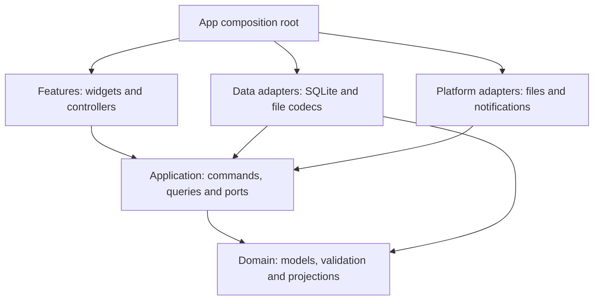

# Architecture

Updated: 2026-11-10. Status: **target architecture, not implemented**. Cadence's product goal is to serve students across Kyushu University through Windows, Linux and macOS applications. A web application is a candidate for feasibility assessment; mobile applications are outside the plan. The current executable is the small Today placeholder in `lib/main.dart`. The retained Android runner is legacy scaffolding, and there is no iOS or web runner. The learner's task-model exercise is separate from the persistence design below. [REDESIGN.md](REDESIGN.md) defines behavior; [LEARNING.md](LEARNING.md) defines teaching order.

Manual planning and local import require no account or server. Authorized university authentication and read-only timetable access are conditional future capabilities, not prerequisites for the local core. No school approval or usable timetable API has been established. See [ADR-002](adr/002-university-wide-product.md) and [university integration](UNIVERSITY_INTEGRATION.md) for the product boundary and unresolved dependencies.

## Layers

Arrows mean **imports / depends on**, not write order. `app/` constructs concrete adapters and injects them through application-owned ports.



| Boundary | Responsibility | Excluded dependencies |
|----------|----------------|-----------------------|
| `features/` | Rendering, form input, loading/error/pending state | SQL, file codecs, recurrence logic, notification plugins |
| `application/` | Use cases, repository/clock/platform ports, transaction and refresh coordination | Flutter, drift-generated rows, plugin types |
| `domain/` | Plain Dart models, weeks, occurrences, task groups, conflicts and aggregates | I/O, system time, provider/widget state |
| `data/` | Port implementations, migrations, transactions and validated file formats | Page navigation or a second copy of domain rules |
| `platform/` | Native file dialogs, lifecycle and notification capabilities | Ownership of canonical course/task data |
| `app/` | Startup, wiring, routing and themes | Shared business logic |

Features communicate through application queries/commands, not each other's controllers. Ports expose domain values and typed outcomes; database rows and file/plugin DTOs are mapped inside adapters. Add concrete operations for use cases instead of a generic CRUD framework. See [ADR-001](adr/001-local-application-boundaries.md) for the decision and alternatives, and [APPLICATION.md](APPLICATION.md) for transaction, query and recovery contracts.

Widgets do not read SQL or parse import files. Domain functions do not depend on Flutter widgets, the database or system time. Inject a clock for Today and overdue calculations. Repositories expose streams; application use cases group related mutations into transactions.

Begin with plain Dart models and Flutter's built-in local widget state. Introduce Riverpod when multiple screens share state and drift/SQLite when implementing desktop persistence. Current installed dependencies remain in `pubspec.yaml`. Evaluate platform packages against Windows, Linux and macOS; assess browser support separately if the web candidate is selected. An unavailable capability needs a documented fallback or a narrower release claim. Weekly review uses pure Dart calculations and basic Flutter bars/text initially; no chart service or chart package is required. See [LEARNING.md](LEARNING.md) and [STATISTICS.md](STATISTICS.md).

## Source organization

Create modules when code is introduced, not as empty scaffolding.

```text
lib/
  main.dart
  app/                   # startup, routing, responsive shell, themes
  domain/
    semesters/           # week calculation and period rules
    scheduling/          # occurrences, exceptions, timezone policy, conflicts
    coursework/          # deadlines and completion
    statistics/          # bounded interval aggregates, no UI or network
  application/
    ports/               # storage, clock, timezone, files, notifications
    coursework/          # task commands and Today query
    scheduling/          # schedule query and preview/commit commands
    editing/             # ordered draft saves and promotion
    transfer/            # import, export and restore coordination
    reminders/           # desired-state reconciliation
  data/
    database/            # tables, migrations, transactions
    repositories/
    transfer/            # versioned timetable and full-backup formats
  features/
    today/
    week/
    courses/
    tasks/
    review/              # secondary screen entered from Week
    settings/
  platform/              # files, lifecycle and platform capabilities
  l10n/
test/                    # mirror domain/data/features modules
integration_test/        # add with persisted user flows
```

This tree describes the local implementation sequence. Future approved identity and timetable-source adapters belong behind application-owned ports, outside the domain. Define their concrete interfaces only after the supported protocol and data contract are known. Do not add empty authentication modules, a speculative backend or a general synchronization engine to the current exercise.

| First working slice | Boundary introduced | Exit condition |
|---------------------|---------------------|----------------|
| Task model and in-memory list | Plain model and widget-local state | Add/complete/undo; disclose that closing loses data |
| Saved tasks and drafts | Application command, storage port, SQLite adapter | Restart preserves confirmed data; failures retain input |
| Today and personal plans | Injected clock and bounded queries | Midnight, deadline and resume refresh; counts equal lists |
| Courses and single changes | Shared occurrence projection | Move across weeks, cancel and restore without duplicates |
| Review, files and reminders | Consumers and dedicated adapters | Consistent results, privacy, rollback and native failure checks |

These are incremental boundaries, not prerequisites for the current task-model lesson. Do not create empty modules, install unused dependencies or introduce an event bus/persistent occurrence cache.

## Optional university integration

University login proves identity; it does not grant timetable-data access. Treat authentication and read authorization as separate capabilities, with separate school decisions. A school-approved flow must keep password entry on the approved authentication surface; Cadence must not collect or persist university passwords. Do not substitute simulated login or unapproved scraping if an official interface is unavailable.

An approved timetable-source adapter retrieves a bounded, read-only source snapshot and maps it into import candidates. Application use cases validate semester/period mappings, compare provenance and show a change preview before committing through the existing local writer. Source responses cannot mutate SQLite or screen state directly. Keep local edits and personal arrangements independent of the imported source. Detailed preview, stale-result and disconnect behavior is in [APPLICATION.md](APPLICATION.md).

Record sufficient non-secret provenance to distinguish source, student context, source record and last successfully checked snapshot. A successful check time is not proof that the university changed or verified a class at that time. Missing, partial or failed responses must never be treated as a valid empty timetable. Source deletions and local-edit conflicts require an explicit resolution; an update cannot silently remove coursework or overwrite a user's room change.

The initial integration target is user-initiated refresh with review, not continuous background synchronization. A future background design needs its own consent, frequency, conflict and platform-lifecycle decisions. Until an adapter is available, local manual entry, supported file/paste imports and existing saved data remain usable. A school connection failure or disconnection does not erase the local timetable.

Keep session secrets outside the ordinary schedule database and use a desktop secure-storage adapter only when the approved protocol requires persistence. Exclude passwords, tokens, cookies and other session material from timetable files, full backups, diagnostics and logs. A school-mandated server, if any, needs a separate deployment, operating-cost and data-retention decision; it is not assumed by the local architecture. Browser storage is not a substitute for an OS credential vault. Any web-session design needs a separate assessment under [SECURITY.md](SECURITY.md).

## Web application candidate

The existing `website/` is a static project website, not the planner application or a school-login service. Evaluate a browser planner as a separate candidate before adding a runner or committing to deployment. Compare a client-local application delivered as static assets with a server-backed design only if confirmed requirements need a server. Neither is selected or implemented yet.

The pure Dart domain and application contracts are intended to remain reusable. Browser persistence, file export, multi-tab coordination, notifications and lifecycle require dedicated capability checks and adapters. IndexedDB-backed persistence is a candidate; do not assume a desktop SQLite file, filesystem locking or OS file dialogs exist in the browser. Test transaction behavior, quota failures, storage eviction, private-browsing restrictions and version upgrades before promising offline use or durable storage. Provide explicit export/recovery and disclose that clearing browser data can erase local records.

The trust boundary changes when executable assets are delivered remotely: injected scripts could read browser-held timetables. Keep timetable text inert, restrict scripts and network destinations with a reviewed CSP, avoid unneeded third-party scripts, and use HTTPS. Public static assets must contain no server secrets. A browser school connection must not expose privileged credentials or silently proxy data to an unapproved service. Do not add long-lived university tokens to ordinary browser storage.

If a backend is later justified, require an explicit API/data-flow design, server-side authorization for every student-owned object, separation of student data and scoped school access. Never trust a student/account ID supplied by the client as proof of access. Review secure session cookies, CSRF protection where applicable, request limits, retention/deletion and recovery before a pilot. Detailed data categories, threat assumptions and acceptance gates belong in [SECURITY.md](SECURITY.md), not implementation shortcuts in the web UI.

## Schedule projection

Keep course rules and repeating personal plans as canonical records. Derive occurrence lists for bounded queries. An occurrence identity uses its rule ID and original scheduled date; a move changes its displayed time, not its identity.

Query both base occurrences overlapping the requested window (including overnight starts before it) and overrides moved into the window from elsewhere. Load referenced rules even when their original semester is outside the window. Apply overrides before filtering final intervals and deduplicate by source kind, rule/plan ID and original date. Use the same projection for Today, week rendering, conflicts, review and visual timetable previews. Each consumer supplies an explicit range and scope; notification scope is independent of screen filters.

Read related tables from one consistent database snapshot. Recombining independent table streams can briefly pair a new rule with old exceptions. Query results carry the range, timezone, scope and formal-data generation; controllers discard results from superseded requests. Detailed contracts are in [APPLICATION.md](APPLICATION.md).

Course periods resolve against their semester's period table. Personal plans have explicit start/end values and do not depend on the selected semester. Display all time-based occurrences in the selected display timezone; preserve original timezone metadata.

Do not hard-code one campus, faculty, study level or academic-period pattern as the university-wide model. Validate the existing semester/week representation against representative undergraduate and graduate timetables before claiming coverage. Versioned school presets may suggest dates and periods, but must disclose their source and applicability and remain distinct from a student's confirmed enrollment or a class cancellation.

Editing an entire rule or semester configuration first produces a change preview, including orphaned exceptions and affected plans. Apply the user's chosen resolution atomically.

## Time boundaries

Use calendar dates for semester anchors, selected teaching weeks, exception identity and all-day ranges. Use timezone-aware wall times for timed rules, deriving instants for overlap and cross-zone display. Do not advance teaching weeks by adding a fixed number of seconds across daylight-saving transitions.

All-day end dates and timed interval ends are exclusive. Same-day deadlines without a time become overdue on the next local date. Ambiguous/nonexistent local times require explicit handling before storage. Keep timezone conversion and recurrence expansion behind one tested module.

## Files and data safety

Timetable export is an allowlisted projection of canonical rules, not a database dump or a serialized week of occurrences. Its content preview comes from the exact payload to be written; its visual schedule preview may use the shared projector. Full backup is a separate versioned format. Validate size, schema version, references and business constraints before opening a write transaction. Future unsupported versions must fail with an actionable message.

Imports remap IDs and store provenance for duplicate detection. Duplicate names are allowed; duplicate imported identities are handled explicitly. Restore takes a backup and validates in staging before replacing data. Never overwrite a live SQLite file from an arbitrary copied file or a cloud-sync folder.

University connection credentials and account identifiers are not part of timetable sharing. Full restore cannot reestablish a school session from a backup: any connection requires fresh authorization and a verified match to the intended student context before it can update source-linked records. Minimal non-secret provenance and its backup policy are specified separately from session material in [DATABASE.md](DATABASE.md).

## Platform boundary

Keep standard Flutter desktop folders. No Android or iOS product release is planned; the retained Android runner does not change that scope. Share the domain and application layers across desktop targets, and evaluate reuse separately for the web candidate. A Windows pilot can validate the local model, but university-wide claims still require evidence of timetable coverage, usable languages/accessibility and the availability of the declared supported platforms.

Test file dialogs, paths, keyboard input, text scaling, accessibility, persistence and resume behavior on each supported desktop host. CI debug builds prove compilation, not runtime behavior or signing. Running-process system notifications are planned behind a mockable platform adapter; see [NOTIFICATIONS.md](NOTIFICATIONS.md). Background/closed-process behavior is a separate acceptance stage on every platform; desktop behavior cannot be promised for a browser build. Draft persistence and revision ordering follow [EDITING.md](EDITING.md).

For data structures see [DATABASE.md](DATABASE.md), for validation [QUALITY.md](QUALITY.md), and for delivery [RELEASE.md](RELEASE.md).
