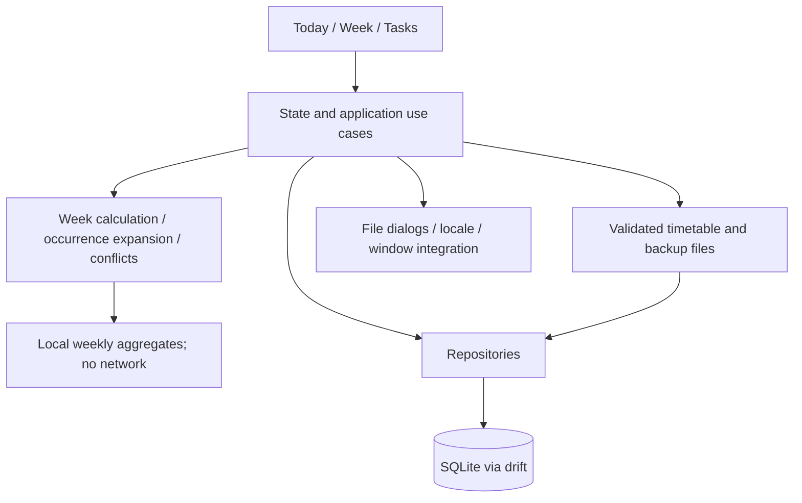

# Architecture

Status: target architecture for the local course and personal planner. The current executable is the small Today placeholder in `lib/main.dart`. [REDESIGN.md](REDESIGN.md) defines product behavior.

## Layers



Widgets do not read SQL or parse import files. Domain functions do not depend on Flutter widgets, the database or system time. Inject a clock for Today and overdue calculations. Repositories expose streams; application use cases group related mutations into transactions.

Begin with plain Dart models and Flutter's built-in local widget state. Introduce Riverpod when multiple screens share state and drift/SQLite when implementing persistence. Current installed dependencies remain in `pubspec.yaml`. Add platform packages only after checking Windows, Linux and macOS support. Weekly review uses pure Dart calculations and basic Flutter bars/text initially; no chart service or chart package is required. See [LEARNING.md](LEARNING.md) and [STATISTICS.md](STATISTICS.md).

## Source organization

Create modules when code is introduced, not as empty scaffolding.

```text
lib/
  main.dart
  app/                   # startup, routing, responsive shell, themes
  domain/
    semesters/           # week calculation and period rules
    scheduling/          # occurrences, exceptions, timezone policy, conflicts
    coursework/          # deadlines and completion
    statistics/          # bounded interval aggregates, no UI or network
  data/
    database/            # tables, migrations, transactions
    repositories/
    transfer/            # versioned timetable and full-backup formats
  features/
    today/
    week/
    courses/
    tasks/
    review/              # secondary screen entered from Week
    settings/
  platform/              # file dialogs and desktop integration
  l10n/
test/                    # mirror domain/data/features modules
integration_test/        # add with persisted user flows
```

No authentication layer, API adapters or synchronization engine are planned.

## Schedule projection

Keep course rules and repeating personal plans as canonical records. Derive occurrence lists for bounded queries. An occurrence identity uses its rule ID and original scheduled date; a move changes its displayed time, not its identity.

Query both base occurrences in the requested window and overrides moved into the window from elsewhere. Exclude base occurrences that have a cancel/move override. Use the same projection for Today, week rendering, conflict detection and timetable export previews.

Course periods resolve against their semester's period table. Personal plans have explicit start/end values and do not depend on the selected semester. Display all time-based occurrences in the selected display timezone; preserve original timezone metadata.

Editing an entire rule or semester configuration first produces a change preview, including orphaned exceptions and affected plans. Apply the user's chosen resolution atomically.

## Time boundaries

Use calendar dates for semester anchors, selected teaching weeks, exception identity and all-day ranges. Use timezone-aware wall times for timed rules, deriving instants for overlap and cross-zone display. Do not advance teaching weeks by adding a fixed number of seconds across daylight-saving transitions.

All-day end dates and timed interval ends are exclusive. Same-day deadlines without a time become overdue on the next local date. Ambiguous/nonexistent local times require explicit handling before storage. Keep timezone conversion and recurrence expansion behind one tested module.

## Files and data safety

Timetable export is an allowlisted projection, not a database dump. Full backup is a separate versioned format. Validate size, schema version, references and business constraints before opening a write transaction. Future unsupported versions must fail with an actionable message.

Imports remap IDs and store provenance for duplicate detection. Duplicate names are allowed; duplicate imported identities are handled explicitly. Restore takes a backup and validates in staging before replacing data. Never overwrite a live SQLite file from an arbitrary copied file or a cloud-sync folder.

## Platform boundary

Keep standard Flutter platform folders. Test file dialogs, paths, keyboard input, scaling and persistence on each desktop host. CI debug builds prove compilation, not runtime behavior or signing. Running-process system notifications are planned behind a mockable platform adapter; see [NOTIFICATIONS.md](NOTIFICATIONS.md). Background/closed-process behavior is a separate acceptance stage. Draft persistence and revision ordering follow [EDITING.md](EDITING.md).

For data structures see [DATABASE.md](DATABASE.md), for validation [QUALITY.md](QUALITY.md), and for delivery [RELEASE.md](RELEASE.md).
