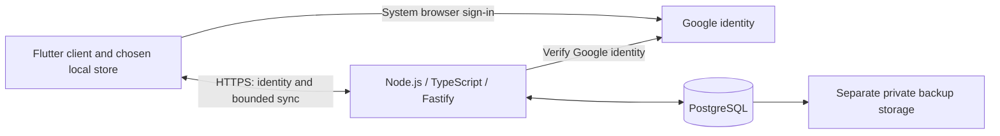

# Optional cloud sync design

Updated: 2026-11-13. Status: accepted future design under [ADR-011](adr/011-optional-sync-service.md); not implemented, purchased or released. The current app keeps tasks in memory. [ADR-013](adr/013-local-planner-and-conditional-academic-access.md) now prioritizes a shared local time-management and direct-editing flow, first working on Windows and then validated on Android. Cloud implementation still follows the post-store service gate in [ROADMAP.md](ROADMAP.md). The learner writes core features in small lessons.

## Purpose and boundary

Help one person continue a task or plan on another device without making local planning depend on a service. Use Google login, a Node.js service written in TypeScript with Fastify, and PostgreSQL. Keep the current Flutter app and its planned local drift/SQLite store. PostgreSQL is the server's store, not a replacement for local saving.

The first service covers chosen tasks, personal plans and essential planning settings. Imported commitments and supported occurrence corrections use the same local planning model; their eventual sync must preserve parent and occurrence identities. Exclude raw files, screenshots, cloud AI, collaboration and external school systems. Use the same published service limits for everyone. No subscription, payment or ad view grants extra access or capacity. The website remains a separate concept presentation; native clients can use this backend without a Web planner. Neither the first Windows/Android planning flow nor optional local screenshot recognition requires this service. Academic access is a deferred extension; this service supplies no school permission or academic interface.

## Identity and data ownership

Choose Google's supported sign-in flow for each client platform. For desktop, use the system browser, an authorization code and Proof Key for Code Exchange (PKCE with S256), which ties the returned code to the request that started login. Validate the configured redirect and request state. Do not use an embedded WebView or treat a secret bundled in the app as confidential. Request only the identity scopes needed for sign-in; calendar and school access are not part of this service. Resolve mobile and Web flows separately before enabling sync on those clients; their local releases do not require login. Source: [Google desktop authorization guidance](https://developers.google.com/identity/protocols/oauth2/native-app).

Use a maintained Google authentication library to verify the identity token's signature, intended audience, issuer and expiry. Use Google's stable subject identifier to map the identity to an internal Cadence user. An email address or a user ID sent by the client is not proof of identity. Source: [Google token validation](https://developers.google.com/identity/gsi/web/guides/verify-google-id-token).

Cadence must establish and revoke its own service sessions and check ownership on every read and write. Do not give clients database credentials or trust a supplied owner field. Keep privileged credentials on the server. Store any persistent client session using the platform's selected secure storage, outside planner records and exports. Define token expiry, rotation and revocation before implementation.

The JPY 2,500 monthly budget covers the proposed personal sync scenario only. Do not assume it covers an academic proxy, institution-required hosting, audits or source fees; estimate those only after an interface and its terms are known.

Google login is for the optional service. It is not school authentication and grants no access to academic systems. Google manages its account password and recovery; Cadence must still support service logout, deletion and account isolation. Losing access to the identity provider must not erase local data. No local-only startup needs a Google request.

## Enabling sync

Signing in only identifies the account. Before enabling sync, show the signed-in identity, the selected local workspace, whether cloud data already exists, what will leave the device and how to stop the service. Require an explicit choice before the first upload or download.

The first sync pilot uses an explicitly saved local workspace so offline edits can be retained. Temporary use stays a local memory session and does not silently enable a persistent queue or upload. Supporting temporary cloud access would need a separate lifecycle design.

For an empty cloud workspace, preview the records to upload. For existing cloud data, offer a clear choice of a separate local copy or a reviewed migration path. Do not silently combine two workspaces or replace either copy. Treat initial merge and replacement as separate reviewed operations, not a side effect of login.

## Sync behavior

- Confirm a local write before showing that an edit is saved on this device. Show pending sync separately from confirmed remote receipt. Cloud delay must not turn a confirmed local save into a failure.
- Assign stable record identities and record versions. Submit each change with a stable operation identity so retrying an uncertain request does not apply it twice. The server checks the account and expected version in one transaction.
- Download only a bounded set of changes after a confirmed server checkpoint. A checkpoint marks how far the client has safely applied changes; advance it only after the local commit succeeds.
- When versions conflict, keep the local edit and the server version available for review. Do not silently discard one based on the device clock. The first pilot must define and test the user's resolution flow before allowing concurrent edits.
- Propagate deletion through a deletion record, often called a tombstone. Define its retention and the recovery route for a client that returns after that period. An old device must not recreate deleted data without review.
- Bound batch size, record size and retries. Back off after failures and spread reconnect attempts over time. Do not fetch the full workspace repeatedly or keep a constant connection without a measured need.
- Use the same validated task, date and repeat rules on both sides. The server is not allowed to accept invalid data merely because a client sent it.
- Validate parent/occurrence references and apply related corrections consistently. A moved or cancelled commitment must not become a duplicate active occurrence after retry, conflict resolution or restore.

These are required behaviors, not a completed wire protocol. Endpoint shapes, queue limits, checkpoint expiry, conflict UI and retention periods must be resolved during their implementation lessons. Do not add speculative fields or a queue to the current task exercise.

## Logout, switching, clear and restore

Keep each queue tied to its account and workspace. Before voluntary logout or account switching, inspect pending and uncertain changes. Offer to finish syncing, retain or export a recoverable local copy, or explicitly discard pending work. Allow cancellation. After switching, old callbacks and queues must not submit records to the new account.

When a session expires or is revoked, stop remote work and keep unsent local edits. Ask for the correct identity before resuming. A new login alone must not attach another user's cloud records to the old queue.

Local clear and cloud deletion are different actions. Local clear must explain whether remote copies remain; it must not enqueue a bulk cloud deletion. Cloud account or workspace deletion needs its own confirmation, revokes relevant sessions and invalidates old sync state. Preserve an explicit local export option where the user still has access. Define backup retention and when remote copies leave backups before offering a deletion promise.

A local backup restore is not permission to overwrite cloud data. Pause sync before restore, preserve recovery data and review the restored workspace's identity and upload consequences. Do not replay old session credentials, checkpoints or operation receipts from a backup. Restart sync only through a deliberate, reviewed reconciliation. See [application contracts](APPLICATION.md) and [data protection](DATA_PROTECTION.md).

## Deployment and operating budget

Start with one API process and one PostgreSQL database on one small Linux VPS. Use a maintained HTTPS reverse proxy and process supervision. Test a small database connection pool, initially 5-10 connections, leaving administration headroom. Connections are shared by requests; they are not one per registered user. Sources: [Node PostgreSQL pool sizing](https://node-postgres.com/guides/pool-sizing), [PostgreSQL connection resources](https://www.postgresql.org/docs/current/runtime-config-connection.html).

Use supported, patched runtime and database versions. Keep CPU-heavy jobs, large JSON inputs and synchronous file work away from ordinary request handling. Do not add Redis, Kubernetes, a separate identity server or microservices without a measured requirement. Source: [Node event-loop guidance](https://nodejs.org/en/learn/asynchronous-work/dont-block-the-event-loop).

The accepted planning budget is **JPY 2,500 per month**, or JPY 15,000 for six months. A reference allocation is below. It is not a purchase, binding quote or billing cap.

| Item | Monthly JPY | Basis |
|---|---:|---|
| Small 2 GB Linux VPS | 1,738 | Reference Sakura Ishikari monthly price, checked 2026-11-13 |
| PostgreSQL | 0 additional hosting/license | Shares the server already counted |
| Direct Google sign-in | 0 | No separate managed identity subscription in this design |
| Domain | 200 | Planning allowance; registration/renewal is normally paid annually |
| Separate backup storage | 200 | Allowance to verify against data size and retention |
| Contingency | 362 | Unspent reserve is not actual cost |
| Total | 2,500 | Excludes development labour, devices and store fees |

The reference provider has a minimum contract term; review the actual region, price, billing schedule and terms before purchasing. Other providers remain possible. Direct Google identity setup is separate from paid identity brokers or other Google APIs. Sources: [VPS prices and terms](https://vps.sakura.ad.jp/specification/), [Google sign-in setup](https://codelabs.developers.google.com/codelabs/sign-in-with-google-button).

Track storage, queries, traffic, backups and support time. Review actual cost against the budget monthly. Use transparent admission and common quota rules to keep the pilot bounded. If cost cannot stay within the agreed budget, pause new admissions or end the pilot with export and local-use guidance. Do not silently delete records, force ads or promise unlimited hosting. An alert does not enforce a hard spending cap.

## Capacity and delivery gates

There is no verified supported-user count. Use **1,000 daily active sync users as the first load-test target**, not as a release claim. With the unmeasured assumptions of 100 HTTP requests per user per day and a peak 20 times the full-day average, that is 100,000 requests per day, about 1.16 requests per second on average and 23 at the assumed peak. Request size, records per batch, retained history and backups can change the actual load.

Test real incremental reads and writes, first sync, retries, conflicts, reconnect bursts and realistic retained data. Run the load generator away from the server. Record latency, errors, CPU, memory, database waits and disk growth while preserving recovery headroom. A generic framework benchmark or successful build does not establish capacity. Increase the target or publish a limit only from measured results.

Before a pilot, verify all of the following:

- Cross-account requests and expired or revoked sessions cannot read or change another user's data.
- Offline edits, duplicate requests, uncertain writes, conflicts and deletion recovery preserve the intended records.
- Account switching, clear and local restore cannot leak data, erase cloud records silently or revive deleted data.
- Backups are stored away from the live server; restore works on a clean system. State the tested recovery limits.
- The client remains useful locally during service failure. Before a planned shutdown, provide notice and export; define the deletion schedule.
- The real monthly charge, provider terms and common service limits fit the approved operating plan. No advertising revenue is assumed before a supported channel produces measured results.

Sync is not a backup: it can propagate a mistaken change. Maintain separate recovery copies and explain their scope. No uptime, encryption or response-time guarantee is made by this design.
