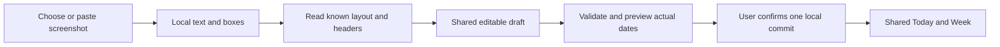

# Optional reviewed screenshot import

Updated: 2026-11-13. Status: **optional design, not scheduled or implemented**, under [ADR-013](adr/013-local-planner-and-conditional-academic-access.md). The maintainer moved screenshot import out of the delivery baseline. Reconsider it only when actual use shows an unmet entry need. This file retains a possible design; its checks apply only if this feature is selected later. Windows and phone delivery do not wait for OCR. Keep tasks, deadlines and personal plans useful without a timetable. All users receive the same free functions; no paid tier or paid import capacity is planned.

Build direct in-app plan and timetable editing first. There is no required screenshot experiment, parser lesson or OCR package in that sequence. Users do not need to create a CSV or another table. Separately assess whether a school offers authorized read-only access under [UNIVERSITY_INTEGRATION.md](UNIVERSITY_INTEGRATION.md); permission and technical availability are not established. That study also does not block local delivery. If later evidence justifies screenshots, start with one useful PNG/JPEG layout. RapidOCR remains a candidate, not a proven Flutter or Android integration. No package, model or service is installed by this document.

Build direct editing, the explicit local/temporary choice and private recovery. Complete the useful Windows planner and adapt it to Android without waiting for macOS/Linux completion. Validate iOS when the necessary host and devices are available. If import is added later, reuse date rules and test its file access, storage, lifecycle and recognition packaging on each supported platform. See [PRODUCT.md](PRODUCT.md), [EDITING.md](EDITING.md) and [ROADMAP.md](ROADMAP.md). The learner writes the features in small lessons.

Before declaring screenshot import ready, support at least one useful layout found in actual samples. Compare the complete screenshot flow with entering the same schedule directly in Cadence. If it fails that comparison or date checks, keep manual editing usable and report screenshot import as unready. A CSV demonstration cannot satisfy this gate. The supported flow uses only user-provided images, without school login, scraping, a source subscription or cloud AI. Ask for term or period context only when the chosen layout needs it.

## Local input and tools

| Input | Planned handling |
|---|---|
| Direct in-app entry | Required foundation: title, actual time/date, optional room/location and bounded weekly repeats; support individual corrections |
| PNG or JPEG screenshot | Optional, unscheduled: reconsider from observed need; if selected, choose or paste one image and review a supported layout after local recognition |
| Native Cadence file | Required private backup parser is separate from adding a timetable; filtered native timetable sharing remains optional |
| CSV or pasted table | Deferred until users have real exported files that justify this route; no preparatory template is required |

OCR means reading text from an image. It does not by itself turn a table into a correct schedule. Local rules must group cells, match headings and read dates, times and repeats. Let users compare the screenshot with the draft and correct it. Reject unreadable content with guidance. Do not promise arbitrary document understanding.

The earlier study selected RapidOCR for evaluation. Recheck its code, models, language packs and native dependency licenses before distribution. A desktop experiment does not establish Android or iOS support. Compare feasible local packaging options against actual samples before choosing a runtime; do not assume a Python-based desktop worker can ship on a phone. Test Japanese, English and Chinese only with models and layouts actually included in the claim.

If the chosen local engine needs models, package them or provide an explicit installation/download step with version and checksum checks. Explain size and location. Once resources are ready, supported import must work offline without an API key or a manual Python install. Measure installed size, peak memory, processing time, cancellation, background/foreground behavior and cleanup on Windows and the first Android target. iOS and other platforms require their own evidence. Do not create unused runtime layers now.

Start screenshot feasibility with one image per import. Users take and crop it with ordinary system tools. Capturing a PDF as an image may be tested for a supported layout, but is not a promise to support every PDF. Direct PDF import, arbitrary XLSX, a built-in camera/editor and image stitching remain outside the first route. Further supported screenshots use the same flow with duplicate review.

## Deferred structured-file import

CSV and pasted-table import are deferred. Reconsider them only when people already have useful export files. Do not ask users to type a spreadsheet before they can import, and do not add a CSV package or lesson as a prerequisite for screenshots. Any later file parser must use the same draft, validation and confirmation rules.

## Manual editing foundation

Use the ordinary plan editor for a class, work session or appointment. It accepts a title, actual start/end date and time, optional room/location and a bounded weekly repeat. Validate real dates, time order and finite repeat bounds. Tasks remain separate entries with optional deadlines. School identity and semester setup are not required for ordinary plans or tasks.

Support individual time/room changes, cancellation and restore for repeated timetable entries, using [HOLIDAYS.md](HOLIDAYS.md). The first screenshot layout supports same-day timetable intervals; unsupported overnight entries need correction or explicit exclusion. Manual personal-plan editing retains its separate overnight rules.

Period tables, teaching-week anchors and odd/even patterns are conditional. Add only the rules required by the selected useful screenshot layout. Otherwise mark them unsupported. Do not flatten an even-week class into an every-week event or invent its term dates. Preview the actual dates after the user supplies any required context.

## One review and commit flow

Choose or paste a PNG/JPEG screenshot → check limits → recognize text and positions → parse the supported layout → correct the draft → preview actual dates → confirm → commit the complete selection. Offer Import after the storage choice and from Week, with direct manual entry alongside it. Make the supported layout clear before image selection.

Provide a file picker and keyboard access as alternatives to desktop drag and drop. Phone review must keep source and draft comparison usable without a wide table: show a readable source preview and one entry's editable fields, with a clear return to the batch. Preserve draft edits while navigating. Show progress and cancellation. Parsing and recognition must not freeze the interface.

Keep each candidate's source image region in memory for comparison with the original. Show title, location, date or weekday, time or period, week rules and exceptions. Mark inferred and missing fields. A model's confidence score is not proof of correctness.

For example, "Wednesday, periods 3-4, even weeks 2-16" needs supported teaching-week rules, a first-week anchor and period times. If that rule type is enabled, ask for missing context; otherwise mark it unsupported. Do not invent values. Personal plans need dates and timezone rather than a semester. Unresolved selected rows block confirmation until corrected or explicitly excluded.

Show extracted, selected, excluded and unresolved counts. Software cannot always detect a missing entry, so require comparison with the source. Let users explicitly exclude candidates. All selected entries must pass the same domain checks as manual entry. Preview real occurrences, overlaps and possible duplicates. A shared name is not enough to merge or delete records. Screenshots lack reliable native IDs, so repeated imports need another duplicate review.

Recognition never writes records. Recheck the reviewed draft and local data revision before commit. A changed file, edited draft or changed local data needs a fresh preview. Commit the selected batch through the application writer in one transaction, or change the in-memory snapshot as one operation in temporary mode. Failure preserves existing records and the editable draft. Reject late results after cancellation, clearing, mode changes or a new import. A second confirm must not write the same batch twice.

## Implementation in small steps

This conditional design uses one editable import draft and one confirmation path. Do not add it to the current lessons just to prepare for possible OCR. If the feature is later selected, internal in-memory examples can test review before recognition fills the draft. Those examples are development data, not a file format users must prepare. Reuse the manual editor's validation and planning model. Recognition never writes directly to the schedule. No parser, OCR bridge or new storage layer is implemented by this document.

### Shared draft

Keep the draft in memory and separate it from confirmed planning records. Each candidate has a temporary ID, a selected/excluded state and these fields:

| Draft part | Content and rule |
|---|---|
| Source | Screenshot text regions and bounding boxes; keep original text and image regions available for comparison |
| Entry | Title and optional location; missing values remain missing |
| Schedule | Either an explicit date with start/end times, or a supported weekday rule with finite start/end dates; retain source period/week notation until it is resolved |
| Context | Confirmed timezone; term year, first teaching-week date and period-to-time mapping only when the source needs them |
| Review | Field errors, ambiguity flags, optional OCR confidence and the user's corrections; a confidence score cannot approve a date |

A bounding box identifies the image area where text was read. It helps show why a candidate has a particular value. Draft IDs and source images are not permanent schedule IDs or automatic attachments. After confirmation, save the validated planning data and necessary recurrence identity, not the screenshot or disposable recognition buffers.

### Parse one declared format

OCR first returns text and positions. A separate parser groups cells by their positions, finds supported day/time headers, associates titles and rooms, and reads available term context. Start with one useful layout from actual screenshots. Merged cells, clipped headers and inconsistent alignment may require correction or rejection. OCR alone cannot decide which text belongs to which weekday or repeat rule. A rejected layout must leave direct in-app editing available.

Normalize full-width and half-width digits, spaces and supported punctuation for parsing tokens while preserving the original source text. Do not rewrite a title without showing the interpretation. Do not guess that a missing time is 09:00 or that an unclear letter is a digit.

If a source says "periods 3-4", use a period table the user has confirmed to derive the actual start/end times. If its year, term start, timezone or week meaning is absent or ambiguous, ask for that value in the review screen. Show the resulting dates before confirmation. If the rule type itself is unsupported, mark it unsupported rather than asking for context that the parser cannot use.

### Review, duplicates and commit

Expand supported rules over a bounded preview range and apply the same date/overlap rules as manual entry. Compare against both the draft and existing records. A possible-duplicate key can include normalized title, date or bounded weekday rule, start/end times, timezone and location. Use it to flag candidates for review, not as proof that two entries are identical. The same title at two times can represent two real classes; even an exact match needs an explicit keep/skip decision. Never merge by title or silently overwrite a corrected occurrence.

Confirmation captures the reviewed draft version, source version, storage mode and local data revision. Revalidate them through the application writer, then insert the selected bounded batch in one local database transaction. Temporary mode replaces its in-memory snapshot as one operation. A failure changes no planning records. The accepted records feed the same schedule projection as manually entered plans; imported classes do not need a separate Today or Week engine.

Give each import attempt a generation ID. Cancellation, a new source, clearing data or switching storage mode invalidates it. Check that ID before accepting asynchronous parser/OCR results and again before commit, so late callbacks cannot revive a discarded draft. Lock duplicate confirmation and reject a batch already committed. Source limits and cancellation checks also apply while parsing and expanding repeats.

### Learner sequence and proof

1. Deliver manual planning, date rules, bounded weekly repeats, saving and private recovery first. Do not require screenshot samples or OCR to accept that product or start Android adaptation.
2. Reopen this work only after observing an unmet entry need and deciding that screenshots are a useful route. Build draft preview and correction with internal in-memory examples. Reuse manual-entry validation; do not introduce a CSV format or package.
3. Evaluate local text recognition and layout parsing for one actual screenshot layout. Connect a feasible implementation to the shared draft, with explicit missing-context and ambiguity handling.
4. Complete duplicate review and atomic confirmation. Check that rejection, cancellation and double confirmation preserve correct records. Add only code and dependencies used by the current lesson; no empty adapter layers.
5. Compare screenshot selection, processing, review and correction against entering the same schedule directly in Cadence, using samples not used to tune the parser. Require the declared time saving and zero unresolved critical date errors. If this fails, keep manual editing usable and mark screenshot import unready. Test the packaged offline path on Windows first, then Android separately; Android acceptance does not block the Windows release.

RapidOCR remains a candidate. Its [official repository](https://github.com/RapidAI/RapidOCR) describes OCR tooling and deployment choices; that is not evidence that Cadence's Flutter bridge, chosen language models or Android package work. Record the selected versions, licenses, model resources and native test results before enabling screenshot import. The [release evidence](#accuracy-and-release-evidence) remains the gate.

## Optional cloud AI with a personal API key

This section retains the earlier optional design for later review. It is outside the first import release and cannot substitute for a usable local route or its acceptance evidence. No provider is selected or implemented. Cadence does not fund a shared cloud AI account. If enabled later, the user's provider may charge them; a personal key does not guarantee free quota or model access. Do not require a Cadence account or operate a request relay.

Allow more than one provider profile, with one selected per request. Do not add a provider marketplace or automatic model routing. Each profile has a display name, service address, model and separate key reference. The user selects a profile for each request. An OpenAI-compatible interface is an initial adapter option, not a promise that all providers behave alike. Add separate adapters only when needed and tested. Record image input, text input, structured output, limits and errors for each provider/model combination. No provider is verified yet.

Cloud help may receive locally extracted text and positions, or the imported screenshot if the model supports vision. Show the exact content before sending it. Disable unsupported choices rather than silently changing the payload or provider.

Before each send, show the provider host, model, selected content and whether images leave the device. Require an explicit send action. Local saving, entering a key and selecting a profile are not upload consent. Never fall back to cloud automatically. Changing provider or increasing content needs another review. Provider retention rules apply even in temporary mode; local clearing cannot recall uploads.

Keep keys in memory by default. Offer a separate Remember key choice backed by the operating system's credential store. Temporary use must not save a new key or automatically load a remembered one. Offer an explicit choice to use a saved key for this session. Never put keys in planning records, exports, ordinary settings, logs, URLs or source files. A missing or locked key store must not cause plaintext fallback. Removing a profile clears its saved key and memory copy; provider-side revocation is separate.

Use HTTPS with certificate checks. Show the destination before sending a key; do not forward credentials across redirects or to another host. Imported text cannot select an endpoint, model or key. Instructions inside screenshots and AI responses are untrusted data, not commands. Grant no tools, file access or arbitrary URL fetching to extraction requests.

Set finite input, output, time and concurrency limits. Allow cancellation and no automatic billable retries in the first version. A timed-out request may still have been billed; explain this before a manual retry. Do not show an exact cost without current pricing and usage evidence. Wrong keys, quota errors, unsupported models and malformed output leave local import usable. Never silently switch providers. Check AI output with a strict schema and the same domain rules as local extraction; it can only update a draft.

## Privacy and input limits

Set and test finite file bytes, decoded pixels, field lengths, records and recurrence limits before enabling a format. Existing private JSON limits do not define image limits. Bound image decoding work, not just compressed file size. Reject corrupt, oversized or unsupported files with clear errors. Do not execute recognized text or follow links in it.

Keep screenshot bytes, OCR results and drafts in memory where possible. Do not copy screenshots into backups or keep them as automatic attachments. Temporary mode must leave no app-owned private disk cache; disable a path in that mode if its dependencies cannot meet this rule. Shared model files contain no user data and may remain installed. Cancel, close and clear must release private buffers and clean permitted temporary files. Test crash cleanup without claiming secure physical erasure. See [SECURITY.md](SECURITY.md) and [DATA_PROTECTION.md](DATA_PROTECTION.md).

## Accuracy and release evidence

The goal is less total setup work while keeping the final schedule correct. A partial draft can help if review and correction take less time than manual entry. Users must be able to compare the source, correct fields and add missing rows without starting again. No Cadence accuracy or effort-saving measurement exists. Valid JSON, model confidence and a passing build do not establish timetable correctness.

Before a screenshot-feature pilot, choose at least one useful screenshot layout from permitted, anonymized samples with human-checked answers. This is not a gate for the manual planner or an approved academic-source pilot. Record the supported languages, layouts and date rules. Keep development examples separate from final evaluation. Include corrupt, clipped, missing-date and unsupported-rule examples to verify rejection. Odd/even weeks, complex layouts and overnight timetable rows must either be supported and checked or clearly rejected; they are not automatic scope additions. Do not upload real samples.

Compare screenshot import with direct in-app manual entry for the same schedule. Include obtaining/cropping and selecting the screenshot, processing, review and correction in total completion time. Do not use CSV creation as the manual baseline. Balance task order to reduce memory effects. Record exact versions, settings, sample counts and hardware. The declared supported route must be faster overall and leave zero unresolved critical date errors after review. A critical error includes a wrong or missing occurrence date/time, an extra occurrence or an incorrect cancellation. Also check final titles and rooms. Report:

- Exact field accuracy for titles, weekdays, times, rooms and week rules.
- Correct complete rules and expanded dates before human correction.
- Missing, invented and duplicate entries; include rejected inputs in the coverage report.
- Correction rate, time to finish review, processing time, peak memory and installed size.
- Supported and rejected formats, plus separate Windows and Android results; no cross-platform accuracy or packaging assumption.

Set a numeric time-saving target before final evaluation, beyond the minimum requirement that the complete flow beat direct in-app entry. Report where manual editing remains faster. If no useful screenshot layout passes, keep the screenshot gate open and the manual planner usable. Do not substitute a CSV demo for screenshot acceptance or hide language/layout failures in one percentage. Every selected entry needs review and validation. No silent writes, dropped rows, automatic uploads or partial commits are acceptable.

First-route failure checks include cancellation, late results, duplicate confirmation, changed source files, corrupt/oversized inputs, offline use, unavailable model resources, denied file access, background/foreground transitions and restore after confirmed import. Verify that records stay unchanged before confirmation and errors preserve drafts. Any later cloud path also needs key-store, quota, timeout and invalid-output checks. These checks are planned, not passed.

## References

The official RapidOCR repository was rechecked on 2026-11-13. Recheck version-specific setup when selecting a runtime. These sources describe tools, not Cadence's measured accuracy or platform compatibility.

- [RapidOCR source and license](https://github.com/RapidAI/RapidOCR)
- [RapidOCR installation and inference engines](https://github.com/RapidAI/RapidOCRDocs/blob/main/docs/install_usage/rapidocr/install.en.md)
