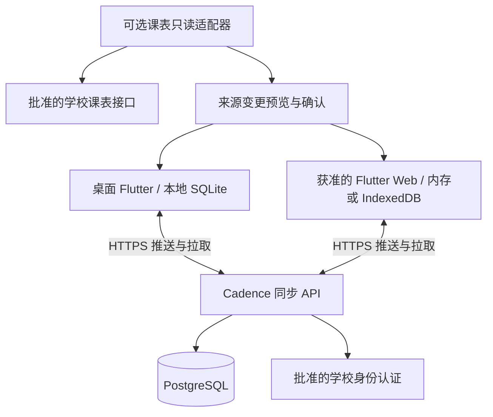

# 多客户端自动同步设计

更新：2026-11-10。状态：条件性方案，尚未实现。对应 [ADR-006](adr/006-optional-multi-client-sync.md)。假设学校允许相关 Web 和账号路线，但具体协议、托管、课表跨设备保留权限仍待确认。当前桌面本地核心继续按原课程实现，不直接增加后台和同步表。

## 1. 产品范围与数据流

第一版同步是同一用户的 Windows/macOS/Linux 与获准 Web 客户端之间同步。没有手机端、教师查看学生私密数据、共享工作区或共同编辑。学校账号用于确认身份，不能据此取得他人规划权限。

学校 API 负责提供学校数据；Cadence 同步服务负责用户已选择同步的规划。个人备注和任务不写回学校系统。学校连接可直连或经过获准中间服务，图中不预设学校允许某种具体协议。

采用一个可维护的后端服务和一个 PostgreSQL 数据库起步，后台清理/备份按需使用定时作业。暂不需要微服务、Kafka、Redis、搜索集群或独立 WebSocket 服务。部署资源按试用实测并发、数据量和学校限流选择，不从“全校用户”直接推导固定机器规格。

## 2. 模式与首次接入

| 模式 | 本机业务副本 | 云端业务副本 | 断网后 |
|------|--------------|--------------|--------|
| 临时本地使用 | 仅内存 | 无 | 当前进程继续；刷新/退出可能丢失 |
| 本机独立保存 | 用户选择持久保存 | 无 | 完整使用已经实现的本地功能 |
| 开启多端同步 | 桌面/浏览器经明确选择保存 | 经单独同意保存 | 已准备好的设备继续本地编辑，重连后补传 |
| Web 临时云会话 | 只在内存，不写业务草稿或 outbox 到磁盘 | 有 | 仅当前页面已有数据可用；未获服务器确认的编辑可能因关闭页面丢失 |

本机保存与上传云端分别说明，登录不默认开启同步。首次开启展示工作区范围、数据类型、运营者、服务器可读性、保留/删除规则和恢复方式。第一版采用工作区整体同步而不是复杂的逐字段开关；未选择同步的本地工作区不会被后台扫描上传。

将已有本地内容转入同步工作区时先预览、校验许可和引用，使用明确的一次性迁移操作；设备已经属于同一同步工作区则按稳定 ID 合并。陌生本地库或备份不因课程标题相同就自动认定同一记录。不同工作区 ID 隔离，禁止跨工作区外键。若本地任务关联了禁止上云的学校课程，先提示解除关联/调整范围，不能通过隐藏 ID 或来源备注泄漏学校数据。

新设备：通过批准流程登录 → 选择已有工作区 → 检查数据协议兼容性 → 分页下载一致快照 → 原子安装本地同步基线 → 从快照游标追赶增量。下载失败不显示空工作区为成功，不覆盖其他本地工作区。只有同意本机保存且离线程序资源可用，才能显示“此设备离线可用”。

## 3. 同步哪些内容

| 数据 | 第一阶段策略 |
|------|--------------|
| 个人任务、完成状态、截止日期、安排 | 同步已确认记录 |
| 手工课程、学期、课时、规则及支持的例外 | 按事务关联同步，不能只传其中一部分破坏引用 |
| 学校课表及最小非秘密来源信息 | 仅学校允许再托管/跨设备保存且用户同意时同步；本地保留许可不自动等于云端许可 |
| 私人课程备注/本地覆盖 | 与学校原始字段分开，按个人记录同步 |
| 未提交编辑草稿 | 第一版不跨设备同步；仅保存到用户选择的本机草稿区 |
| 提醒设置、投递记录、窗口状态、设备主题语言 | 第一版留在每台设备；设备各自重建提醒，不承诺所有设备只提醒一次 |
| 学校令牌、Cookie、设备秘密、outbox、游标 | 不进入业务同步、分享或普通备份；每台设备独立会话 |
| 原始学校响应、诊断日志、附件 | 不作为第一版同步内容；附件需要另行限额、存储与权限设计 |

“今天”和周视图是同一批记录的查询结果，不另外同步整张页面。任务完成写成明确的目标状态，不传“切换一次”。不依赖手机推送或浏览器关闭后的后台执行。

## 4. 身份、会话与账号生命周期

内部 `user_id` 独立于学号和邮箱。外部身份使用提供方与其协议定义的稳定主体标识绑定，并加唯一约束；不能按可变化的邮箱自动合并账户，也不能假定 SAML 一定提供持久不变的姓名标识。学校若不能提供稳定标识，先解决绑定策略再开启长期同步。

学校身份认证协议由批准接口决定。若采用 OAuth/OIDC，按当前安全规范验证发行方、受众、签名、回调、state/nonce 等适用项，使用授权码与 PKCE；原生客户端不是可保守 client secret 的机密客户端。若学校提供 SAML，则使用成熟服务端库处理相应验证，不把 OAuth 参数生搬过去。

Web 可采用同源后端会话入口，Cookie 具有适当 Secure/HttpOnly/SameSite/路径范围并实施 CSRF 防护；桌面使用每设备会话与批准的安全令牌流程。会话、设备状态与业务所有权每次请求都检查，不相信客户端传来的 owner_id。长期令牌不得放普通浏览器存储中；无需为了“统一代码”强行让桌面与 Web 使用相同凭据保存方式。

提供设备列表与单设备撤销。设备名只是显示信息，device_id 不是身份凭证。账号注销、撤销、学校资格失效后停止新的云访问；离线设备已有副本无法保证远程擦除。注销必须清理本机待发送队列和数据上下文，保留个人本地副本仅在明确选择且许可允许时执行，下一账号不能继承上一账号缓存或 outbox。

毕业/离校后的登录期限、导出窗口、身份迁移和云数据删除政策须在上线前确定。不得承诺永远能用学校账号；任何个人账号接续必须验证身份并符合学校条件，不能仅凭同邮箱接管原账号。

## 5. 本地与服务端数据结构

以下只用于未来同步迁移，不能混入当前本地课的简化模型。已有本地 `revision`、`data_generation` 与服务器版本不同，不能复用含义。

| 位置 | 结构 | 作用 |
|------|------|------|
| 服务端 | users / external_identities | 内部用户与学校身份绑定 |
| 服务端 | workspaces | owner_user_id、workspace_epoch、最后已提交 change_seq；第一版一个所有者，无成员协作 |
| 服务端 | devices / sessions | 所属用户、设备/会话状态、撤销和有效期；秘密与业务表访问权限分离 |
| 服务端 | 业务主表及子表 | workspace_id、稳定实体 ID、server_version、受控字段；父子关系必须在同一工作区 |
| 服务端 | change_log | workspace_id、epoch、seq、实体/聚合标识、操作类型和对应版本快照或删除标记 |
| 服务端 | operation_receipts | 工作区/设备/epoch/op_id、请求摘要及原处理结果，支持重试去重 |
| 服务端 | tombstones | 被删除 ID、实体类型、删除版本/序号，不必长期保留私人正文 |
| 本地 | sync_state | 当前账号/工作区/设备身份、epoch、最近已原子应用的游标、协议版本 |
| 本地 | outbox | op_id、目标聚合、base_server_version、依赖版本、变更内容、排队序号、状态 |
| 本地 | sync_baselines / conflicts | 已确认服务端版本及未解决冲突所需最少副本；也属于私人数据 |

业务记录引用使用同工作区复合约束，例如任务 `(workspace_id, course_id)` 只能引用该工作区课程。服务器事务检查当前用户确实拥有工作区；RLS 作为第二道保护，不能替代应用授权。运行时数据库角色不能是 superuser、BYPASSRLS 或未经处理的表所有者；维护/备份账号与普通请求分离。

记录 ID 使用可离线生成的随机稳定 ID；不能把 ID 难猜当授权。服务器采用版本前提条件，拒绝更新不存在的记录；普通 update 不得自动 upsert 成 create，以免旧设备复活删除项。

## 6. 自动同步协议

1. **先保存本地。** 用户确认编辑时，在同一事务提交本地变更与 outbox。临时 Web 只排到内存队列，必须明确其关闭丢失边界。UI 区分“本机已保存”和“云端已确认”。
2. **触发同步。** 启动、回到前台、用户手动刷新、网络恢复和编辑后的短暂防抖触发；显式离线模式不触发。一次只有一个本地同步协调器，同一 Web 工作区的多个标签需协调。
3. **先验证资格并拉取。** 检查会话、设备状态、协议、epoch 和游标有效性；先应用已提交增量，但不得覆盖有未提交修改的本地记录，改为保留基线/进入冲突处理。
4. **提交队列。** 每个操作有稳定 op_id 和 base_server_version，服务端认证、查重、检查版本/所有权/依赖/业务约束，再提交。相同 ID 与相同内容重试返回原结果；相同 ID 但内容不同拒绝。批量请求逐项返回结果，不以整个 HTTP 成功表示全部业务成功。
5. **事务确认。** 一个聚合操作的业务写入、版本递增、变更日志和处理回执必须在同一事务完成。课程规则、周次与例外随课程聚合提交；跨聚合删除/导入采用有界的显式事务命令，不能拆成无法恢复的一半。
6. **消费回执。** 客户端原子记录服务端确认并移除对应操作。期间若用户又编辑了同一项，不能用旧回执覆盖较新本地状态；按已确认基线重算后续操作。结果未知时先以原 op_id 重试或查询回执，不能生成新 ID 盲目重发。
7. **拉取后续变化。** 按服务器 seq 分页获取变更；一页的数据应用和游标推进同一事务。崩溃后重放必须幂等，不能先存游标再写记录。

第一版每个聚合串行提交；尚未发送的连续编辑可合并，已发送的操作不能改内容。课程等依赖先确认后再提交引用它的任务。设备时间只用于用户展示，不作为全局排序和覆盖依据。

服务端 change_seq 必须表示安全的已提交顺序：可在每个工作区行锁内分配并提交业务变更、日志与计数。不能直接用普通数据库 sequence 的分配顺序当稳定增量游标，否则较早取号但较晚提交的事务可能被客户端漏过。快照绑定一致的数据视图与高水位 seq；分页快照不能边翻页边读不断变化的“当前数据”。

第一阶段使用 HTTPS 推送和有界增量拉取。稍后 SSE/WebSocket 仅发送“有新变化”的提示，实际数据仍通过已鉴权增量协议拉取；断开或漏通知不会丢数据。前台空闲拉取周期、请求批量、退避上限由试用实测确定，失败指数退避并加随机抖动，遵守 Retry-After，不反复请求学校 API。

## 7. 冲突策略

| 情况 | 第一版处理 |
|------|------------|
| 两设备修改不同任务 | 各自正常提交 |
| 同一记录提交时版本未变化 | 接受并产生新服务器版本 |
| 两设备改同一任务，包括看似不同字段 | 保守地保留本地与服务端两个版本，让用户选择/合并后基于新版本再提交；后续才评估经过验证的字段级合并 |
| 一台完成，另一台撤销完成 | 不按设备时间猜测意图；显示明确冲突 |
| 一台删除，另一台离线编辑 | 删除成为已提交状态后拒绝旧 update；保留本地冲突副本供用户审阅，可明确另存为新 ID，不自动复活 |
| 两台修改同一课程规则/调课例外 | 以课程聚合版本检查，避免把两组修改拼成非法课表 |
| 学校刷新与私人备注同时变化 | 来源基线和私人字段分开；学校变化沿既有预览确认流程，不以同步机制强行覆盖 |

服务器先确认的合法修改成为当前版本，后来的旧版本操作需要解决冲突，不称为“最后修改时间胜出”。冲突副本也是私人数据，按本机/云端范围保护与清除。冲突不能让整个工作区永久停止同步：仅阻止相关聚合及依赖，其他记录继续。

## 8. 删除、过期设备与恢复

普通删除产生 tombstone 并进入增量流。用户删除内容后，其他设备收到删除；离线设备重连后不允许以旧版本将其覆盖回来。云端整个工作区重置/清除要推进 workspace_epoch，拒绝旧 epoch 的所有操作。

初步运维候选：增量日志与操作回执保留 30 天、最小删除标记保留 90 天，均待学校及隐私政策确认。它们不是记录总寿命。若其中含历史正文，必须纳入删除与保留说明，不能宣称普通删除后所有服务器副本立即消失。

协议强制关联操作有效期/设备同步租约和保留边界：超出安全游标下限、回执窗口或设备租约时，先冻结旧队列并全量重建基线，换发同步代次/租约；旧请求即使以后抵达也被服务端拒绝。未上传的离线编辑保留为本机恢复候选，对照新基线让用户确认后生成新操作，不能给旧队列换 ID 自动重放。不能只清理 tombstone 而继续接受无限期离线写入。

“清除这台设备”只删除本机缓存/草稿/队列/凭据，不向云端产生业务删除；“关闭同步”停止传输，不假装云副本已删除；“删除云工作区/账号数据”单独确认并终止相关会话/写入。云端备份的到期删除、日志最小记录与用户导出副本要分别说明。远程撤销不能保证擦掉离线或被控制设备已经读到的数据。

恢复本地旧备份默认到独立本地工作区，不恢复会话、device_id、op_id、游标或同步租约。要并入云工作区，走差异预览和新操作；不能把旧数据库直接替换后自动同步。明确的云工作区整体恢复/灾难恢复需要新的 epoch 和一致快照，避免保留旧游标的客户端漏变更或重放旧数据。云备份是受控恢复资源，不作为另一台同步客户端直接接入。

## 9. 安全与运营取舍

推荐第一版为受控运营方可处理正文的同步服务：TLS 传输、服务器磁盘/备份加密、密钥与业务库分离、最小权限、逐对象授权及 RLS。访问和运维审计不记录任务正文、课表、令牌或整个请求；日志期限与学校实际要求另定。服务器端能够读取正文，必须如实告知，不能叫 E2EE。

若后续要求端到端加密，需要完整的工作区密钥、设备加入验证、密钥轮换、恢复秘密和撤销协议。学校登录证明身份不自动提供解密密钥；重置登录不能自动恢复密文。服务器只能校验可见元数据、大小与版本，业务正文约束和冲突合并转移到客户端，仍需设计防重放和元数据泄露边界。Web 发布者或被注入脚本可在解锁时窃取明文；不能宣称 E2EE 能防住恶意 Web 发布者。不在此提案自行发明密码协议。

上线前确定运营方、数据区域、费用限额、数据量/请求配额、备份恢复目标、删除期限、私人问题反馈渠道及毕业交接。先以两设备小样本演练故障再扩大；不凭使用 PostgreSQL 就保证全校规模。使用每用户/设备公平限流、分页上限及备份恢复演练，不给管理员默认无限查看私人正文的产品入口。

## 10. 分阶段验收

1. 本地持久化稳定后，用虚构数据验证两台桌面客户端的一项任务同步，不接学校真实账号。
2. 加入离线队列、幂等回执、冲突、删除、过期设备与恢复；通过后再扩展课程等关联聚合。
3. 在许可范围内验证身份绑定、设备撤销、逐用户隔离及学校来源处理；完成运营和隐私条件。
4. 学校允许 Web 部署后，验证浏览器保存选择、多标签、刷新/崩溃和临时会话；再进行有限真实试用。

必须验证：两设备离线编辑重连；请求成功但回执丢失；同 op_id 换内容；服务端事务乱序提交；旧回执遇到新编辑；跨工作区引用与越权；删除后旧设备上线；回执/tombstone 清理后长期离线设备重连；账号切换中的旧请求；中途快照下载失败；不兼容客户端；服务器备份恢复；页面关闭丢失未确认内存队列的准确提示。

UI 至少区分「仅本机」「待同步 N 项」「云端已确认」「离线」「需重新登录」「有冲突」「同步失败」，并区分学校最后读取时间和 Cadence 最后同步确认时间。协议不兼容时保留本地数据并要求升级，不悄悄丢弃未知字段。同步不等于备份，也不保证关闭浏览器后后台运行。

## 依据与参考

查阅：2026-11-10。协议、字段及保留窗口是 Cadence 的提案，不是学校已给出的接口条件。

- [PostgreSQL RLS](https://www.postgresql.org/docs/current/ddl-rowsecurity.html)：逐行权限及 superuser/表所有者绕过边界。
- [OAuth 2.0 安全最佳实践 RFC 9700](https://www.rfc-editor.org/rfc/rfc9700.html)：仅用于实际采用 OAuth 的批准流程。
- [Obsidian Sync 安全](https://obsidian.md/help/sync/security)：参考其对服务端加密与 E2EE、恢复限制的区分；不复制协议或安全保证。
- [Obsidian Sync 冲突说明](https://obsidian.md/help/sync/troubleshoot)：离线多端确实需要冲突处理；Cadence 使用结构化规划数据，选择版本检查与保留冲突，不直接照搬文本合并或最后修改时间覆盖。
