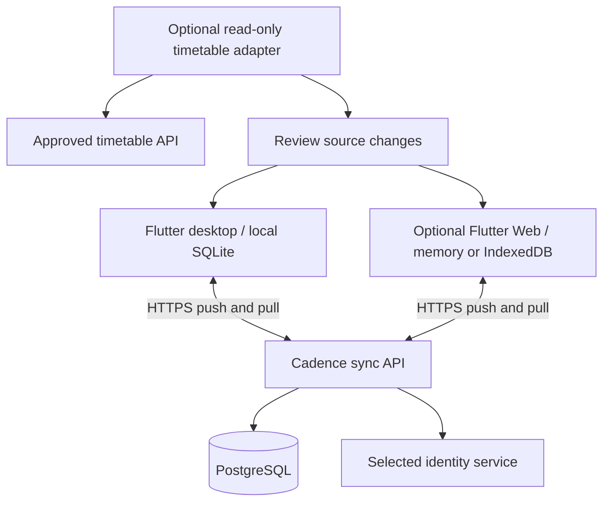

# Optional multi-client sync

Scope update (2026-11-11): [ADR-008](adr/008-small-free-local-product.md) parks this study. Web and synchronization are considered only for a specific school connection that needs them. This is not a general cloud-sync backlog; reuse only the parts justified by that connection. No backend, queue or account implementation is authorized by this reference.

Updated: 2026-11-11. Status: an optional later proposal, not implemented. Read [ADR-006](adr/006-optional-multi-client-sync.md) with [ADR-007](adr/007-general-purpose-local-planner.md), which makes Cadence a general-purpose local planner. The offline core needs no account or service. Sync needs a separate decision on identity, hosting and operation. School permission applies only if a school identity service or school data is included. Continue local desktop lessons without adding a backend or sync tables now.

## Scope and data flow

If built, the first sync version serves one person's Windows, macOS, Linux and optional Web clients. It has no mobile client, shared workspace, collaborative editing or access to another person's private plans. A school account is not required for the local core and is not the assumed identity route for sync.

Cadence sync carries records the user has chosen to synchronize. The identity route must be selected and reviewed before implementing accounts. A school adapter is a separate optional source; private notes and tasks never write back to the school. Such an adapter may connect directly or through an approved intermediary, but needs permission for that interface and data. Ordinary local or Web planning does not depend on that permission.

If sync is selected, start with one maintainable service and one PostgreSQL database. Add scheduled cleanup and backup jobs as needed. Do not add microservices, Kafka, Redis, a search cluster or a separate WebSocket service in advance. Choose capacity from measured pilot traffic, data size and actual upstream limits, not an assumed audience size.

## Modes and first setup

| Mode | Local business data | Cloud business data | When offline |
|---|---|---|---|
| Temporary local use | Memory only | None | Current process continues; refresh/exit may lose data |
| Independent local saving | Explicitly chosen storage | None | Implemented local features continue |
| Multi-client sync | Explicitly chosen desktop/browser storage | Separate consent required | Prepared devices can edit locally and send changes later |
| Temporary Web cloud session | Memory only; no disk drafts or outbox | Present | Only the open page's data remains available; unconfirmed edits can be lost when it closes |

First use of the core offers Save on this device and Temporary use before reading saved records. That decision does not enable cloud upload. Optional sync has its own opt-in; login alone is insufficient. Sync setup explains the workspace, data types, operator access, retention, deletion and recovery. Start with whole-workspace sync instead of field-by-field switches. Never scan and upload independent local workspaces in the background.

Moving existing local records into a sync workspace is an explicit one-time migration with a preview, permission checks and valid references. Devices already in the same workspace use stable IDs. Do not infer identity from matching course titles in an unrelated database or backup. Keep workspace IDs isolated and reject cross-workspace foreign keys. If a task references a school course that cannot be uploaded, ask the user to remove the link or change scope before proceeding. Hidden IDs or source notes can also disclose school data.

A new sync device first selects its local-saving or temporary mode, then uses the reviewed sign-in flow, selects a workspace, checks protocol compatibility, downloads a consistent paged snapshot, atomically installs its baseline in the chosen storage, and pulls changes after the snapshot cursor. Temporary mode must not inspect an unrelated saved database or persist the downloaded snapshot. Failure must not appear as a successfully loaded empty workspace or overwrite another local workspace. Show offline availability after restart only when the user chooses local saving and required application resources are available offline.

## Included records

| Data | First sync version |
|---|---|
| Personal tasks, completion, deadlines and arrangements | Confirmed records |
| Manual courses, semesters, periods, rules and supported exceptions | Related records in one valid transaction |
| School timetables and minimal non-secret source metadata | Only with both school permission for cloud/cross-device retention and user consent; local retention permission is insufficient |
| Private course notes and local overrides | Separate from school source fields |
| Unsubmitted drafts | Device-local only, under the chosen local-saving mode |
| Reminder settings/delivery history, window state, theme and language | Per device; rebuild reminders locally without promising one notification across all devices |
| Service tokens (including school tokens), cookies, device secrets, outbox and cursors | Excluded from business sync, sharing and ordinary backup; sessions are per device |
| Raw school responses, diagnostic logs and attachments | Excluded; attachments need a separate storage, quota and permission design |

Today and Week are queries over the same records, not separately synchronized pages. Send task completion as a target value, not a request to toggle once. Do not depend on phone push or background execution after the browser closes.

## Identity and account lifecycle

Use an internal `user_id` separate from email or an external institution's identifiers. Bind any external identity by provider and its protocol-defined stable subject, with a uniqueness constraint. Do not merge accounts by a changeable email address or assume every SAML name identifier is permanent. Resolve stable identity and account recovery before enabling long-term sync.

Select and review the authentication route for the optional service; it need not use a school. If a school identity provider is offered, obtain permission for that provider separately. If OAuth/OIDC is selected, apply its required issuer, audience, signature, callback, state and nonce checks, using authorization code and PKCE where appropriate. A native app cannot protect a client secret as a confidential server can. If SAML is selected, use an established server library and its validations rather than copying OAuth parameters.

Web may use a same-origin backend session with suitable Secure/HttpOnly/SameSite cookie attributes and path scope plus CSRF protection. Desktop uses per-device sessions and the reviewed token flow. Check session validity, device status and business ownership on every request; do not trust client `owner_id`. Never persist long-lived tokens in ordinary browser storage. Desktop and Web need not store credentials the same way.

Provide a device list and single-device revocation. A device name is a display label; `device_id` is not a credential. Logout, revocation or loss of identity-provider eligibility stops new cloud access. Remote erasure of an offline copy cannot be guaranteed.

For voluntary logout or account switching, pause automatic submissions while inspecting unsent edits and unknown-outcome operations. Offer to finish and confirm sync, export a private recovery copy when its source rights allow it, or explicitly discard the pending work. Allow cancellation. Do not clear the queue merely because Logout was pressed. A permitted export contains recoverable business edits, not sessions, operation receipts or sync credentials. After the chosen resolution succeeds, clear session access and the active account context; remove or retain local records only according to the user's separate choice and retention rights.

For forced expiry, revocation or an invalid session, stop network work immediately. Freeze the existing account's pending queue and unknown-outcome records under that account/workspace; do not silently delete them, change their owner or send them through a new login. A new account cannot read that cache or queue. Recovery requires the same verified identity and a valid workspace/epoch, followed by receipt reconciliation and normal conflict checks. If access cannot be restored, allow only a permitted private recovery export or an explicit discard. Local-saving mode can retain the isolated queue under its existing protection and retention rules. Temporary mode keeps it only in memory: explain the loss on page/process close and do not secretly persist it to prevent that loss.

On any account exit or switch, invalidate the active coordinator generation. A late response from an old session must not repopulate the view, acknowledge another account's work or restart its queue. An already accepted server write may still exist; reconcile its original receipt after verified recovery rather than treating a cancelled local request as a confirmed server cancellation.

Before launch, define identity-provider loss, recovery/export windows, identity migration and cloud deletion. If school login is an optional route, also define graduation or departure behavior; do not promise school access forever. Account handover requires verified identity and any applicable source/provider permission. Matching email alone cannot transfer control.

## Future data structures

Introduce these only in a later sync migration. Local `revision` and `data_generation` have different meanings from server versions; do not reuse them.

| Location | Structure | Purpose |
|---|---|---|
| Server | `users`, `external_identities` | Internal users and any selected external identity binding |
| Server | `workspaces` | Owner, `workspace_epoch` and last committed `change_seq`; one owner, no membership model initially |
| Server | `devices`, `sessions` | User ownership, status, revocation and expiry; separate secret access from business tables |
| Server | Business parent/child tables | Workspace, stable IDs, server versions and allowed fields; related rows stay in one workspace |
| Server | `change_log` | Workspace, epoch, sequence, aggregate ID, operation and versioned snapshot or deletion marker |
| Server | `operation_receipts` | Workspace/device/epoch/`op_id`, request digest and original result for safe retries |
| Server | `tombstones` | Deleted ID/type/version/sequence without indefinitely retaining private bodies |
| Local | `sync_state` | Account/workspace/device, epoch, last atomically applied cursor and protocol version |
| Local | `outbox` | Operation ID, aggregate, base server version, dependency versions, payload, order and state |
| Local | `sync_baselines`, `conflicts` | Minimum confirmed and conflicting copies; these are private data too |

Use same-workspace constraints: a task's `(workspace_id, course_id)` may reference only a course in that workspace. Server transactions check the current user's workspace ownership. Row-level security is a second defense, not a substitute for application checks. Runtime database roles must not bypass it through superuser, BYPASSRLS or unhandled owner privileges. Separate maintenance/backup roles from ordinary requests.

Use stable random IDs that clients can create offline. Unpredictable IDs do not grant authorization. Enforce server-version preconditions. An ordinary update must reject a missing record rather than upsert it, which could revive a deleted item.

## Sync protocol

1. **Save on this device.** Commit the confirmed edit and its outbox item in one transaction. Temporary Web sessions queue only in memory and explain close/refresh loss. Distinguish local save from server confirmation.
2. **Schedule work.** Trigger on startup, foreground return, manual refresh, network recovery and a short delay after editing. Explicit offline mode suppresses requests. Use one local coordinator and coordinate tabs in the same Web workspace.
3. **Validate and pull.** Check session, device, protocol, epoch and cursor. Apply committed remote changes without overwriting local pending edits; preserve a baseline or create a conflict instead.
4. **Submit.** Send stable `op_id` and `base_server_version`. The server authenticates, deduplicates and checks ownership, versions, dependencies and business rules. A retry with the same ID and content returns the original result; the same ID with different content is rejected. A batch returns results per operation, not just HTTP success.
5. **Commit atomically.** Business writes, new version, change log and receipt share one transaction. Course rules, weeks and exceptions form a course aggregate. Cross-aggregate deletion/import uses explicit bounded transaction commands, not independently committed fragments.
6. **Apply the receipt.** Atomically record confirmation and remove that queued operation. If another local edit occurred, the old receipt must not overwrite it; rebase the next operation on the confirmed baseline. When a result is unknown, retry or query the original ID rather than sending a new one.
7. **Pull the rest.** Apply each change page and advance its cursor in one transaction. Replay after a crash must be safe. Never store the cursor before its records.

Submit one operation at a time per aggregate. Unsent consecutive edits may be combined; an already sent operation is immutable. Confirm dependencies, such as a course, before sending tasks that reference them. Device clocks are display information, not the authority for ordering or overwriting.

`change_seq` must reflect a safe committed order. One option is a workspace row lock covering allocation, business changes, log writes and the counter commit. Do not treat an ordinary database sequence's allocation order as commit order: an earlier allocated transaction may commit after a client has passed its number. A snapshot binds a consistent data view to its high-water sequence; do not page through changing live rows and call them one snapshot.

Start with HTTPS push and bounded incremental pull. Later SSE/WebSocket messages may announce that changes exist, but authenticated pull remains the data path. Missed notifications must not lose changes. Set polling intervals, batch sizes and backoff limits from pilot measurements. Use exponential backoff with jitter, respect Retry-After and avoid repeated school API requests.

## Conflicts

| Case | First-version behavior |
|---|---|
| Different tasks edited on two devices | Commit independently |
| Record version still matches | Accept and issue a new server version |
| Same task edited on two devices, even in apparently separate fields | Keep both copies; let the user choose or merge, then submit against the new version. Defer automatic field merging. |
| Completion on one device, undo on another | Show a conflict; do not guess from device time |
| Delete on one device, offline edit on another | After deletion commits, reject the old update. Keep its local conflict copy for review; explicit recovery uses a new ID. |
| Course rules or exceptions edited on two devices | Check the course aggregate version; do not combine rules into an invalid timetable |
| School refresh and private note edit | Keep source baselines and private fields separate. School changes still require their existing review flow. |

The first valid server commit becomes current. A later stale operation needs conflict resolution; this is not last-modified-time-wins. Protect and clear conflict copies as private data. Block only the affected aggregate and dependencies, so one conflict does not stop the whole workspace indefinitely.

## Deletion, expiry and restore

Deletion creates a tombstone in the change stream. Other devices apply it, and old versions cannot overwrite it when they reconnect. A whole-workspace reset or clear advances `workspace_epoch` and rejects all old-epoch operations.

Initial operating candidates are 30 days for incremental logs and receipts, and 90 days for minimal deletion markers. These are not approved retention promises or total record lifetimes. Confirm them against the service privacy policy and any source-specific requirements. If logs contain historical bodies, disclose their retention and deletion; normal deletion does not instantly remove every server copy.

Tie operation validity and device leases to those retention windows. A client beyond the safe cursor, receipt window or lease first freezes its old queue, rebuilds a full baseline and receives a new sync generation/lease. Reject old requests even if they arrive later. Keep unsent edits as local recovery candidates for review against the new baseline. Do not assign new IDs to an old queue and replay it automatically. Tombstones cannot be cleared while indefinitely old writes remain valid.

Keep these actions distinct:

- **Clear this device:** explicitly confirm removal of local cache, drafts, queue and credentials, including any unsent work. Offer permitted recovery export first. Do not send business deletions to the cloud.
- **Stop sync:** stop transfers; do not imply that cloud copies were deleted.
- **Delete cloud workspace/account data:** confirm separately and end related sessions/writes.

Explain backup expiry, minimal log retention and exported copies separately. Revocation cannot guarantee erasure from offline or compromised devices.

Restore an old local backup into an independent local workspace by default. Do not restore sessions, device IDs, operation IDs, cursors or sync leases. Joining cloud data requires a difference preview and new operations, not automatic sync after replacing a local database. Whole-cloud restore or disaster recovery needs a new epoch and consistent snapshot so clients do not miss changes or replay old data. A server backup is a controlled recovery source, not another client.

## Security and operation

The proposed first server can process record bodies. Require TLS, encrypted server disks/backups, separate key and database access, minimal privileges, per-object authorization and row-level security. Logs must exclude task bodies, schedules, tokens and complete requests. Set and disclose log retention, including any source restrictions. State plainly that the server can read records; do not call this E2EE.

If E2EE becomes a requirement, separately design workspace keys, verified device enrollment, key rotation, recovery secrets and revocation. Login proves identity, not access to decryption keys. Resetting login cannot automatically recover ciphertext. Server checks become limited to visible metadata, size and versions; clients must enforce content rules and merge conflicts. Replay and metadata exposure still need a design. A malicious Web publisher or injected script can steal unlocked plaintext. Do not invent a cryptographic protocol in this proposal.

Before launch, name the operator, data region, cost limits, record/request quotas, backup recovery targets, deletion periods, private support route and maintainer handover. Start with two-device fault exercises. PostgreSQL alone does not establish service capacity. Apply fair user/device limits, bounded pagination and restore drills. Do not add a default administrator product view for reading all private records.

## Staged acceptance

1. After the local core is stable and sync is explicitly selected for development, synchronize one fictional task between two desktop clients with test identities.
2. Add offline queues, safe retries, conflicts, deletion, expired-device handling and restore. Then extend to related course aggregates.
3. Test identity binding, device revocation, per-user isolation, logout recovery and any included source rules. Complete privacy and operating requirements. School-source tests apply only to an approved school adapter.
4. If Web is built, test the initial saving choice, multiple tabs, refresh/crash and temporary sessions before a limited real-data pilot. A general Web client does not require school permission.

Required failure cases include offline edits on two devices; a committed request with a lost receipt; reused `op_id` with changed content; out-of-order server commits; old receipts after newer edits; cross-workspace references and access; deleted records meeting an old device; reconnection after receipt/tombstone cleanup; voluntary logout with unsent or unknown-outcome edits; forced expiry while offline; a new account attempting to read or replay the old queue; interrupted snapshot download; incompatible clients; server backup restore; and accurate warnings when an in-memory queue will be lost on page close.

The UI distinguishes local-only, N pending changes, cloud-confirmed, offline, login required, conflicts and sync failure. Show school-source refresh time separately from Cadence sync confirmation. On protocol mismatch, preserve local data and request an upgrade rather than discarding unknown fields. Sync is not backup and does not promise work after the browser closes.

## References

The original review was recorded on 2026-11-10. Protocol fields and retention windows above are Cadence proposals, not school interface terms.

- [PostgreSQL row security](https://www.postgresql.org/docs/current/ddl-rowsecurity.html): row policies and privileged-role bypass.
- [OAuth security best practice, RFC 9700](https://www.rfc-editor.org/rfc/rfc9700.html): relevant only if the approved flow uses OAuth.
- [Obsidian Sync security](https://obsidian.md/help/sync/security): reference for explaining server encryption, E2EE and recovery limits; no protocol or guarantee is copied.
- [Obsidian Sync conflicts](https://obsidian.md/help/sync/troubleshoot): background on offline conflicts. Cadence's structured records use version checks and retained conflicts, not automatic text merging or device timestamps.
