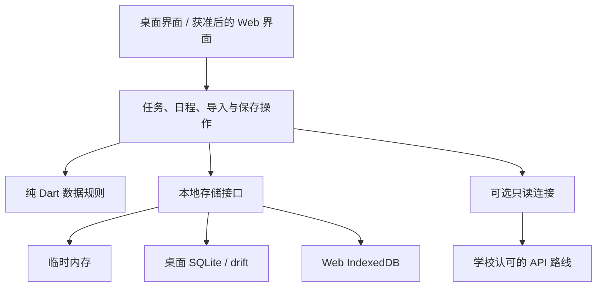

# ADR-005：用户选择本地保存、离线核心与学校许可后的 Web

**状态：** 用户已确定本地保存由本人选择、提供离线模式、Web 规划应用须经学校允许才部署；以下技术方案为推荐设计，尚未实现。
**日期：** 2026-11-10
**决策参与：** 项目维护者决定产品取舍；学校决定相关部署与数据接入许可。
**调整范围：** 补充 ADR-004。桌面优先；Web 保留为后续目标，部署必须经过学校许可。正式离线 Web 推荐 IndexedDB，替代此前 localStorage 小快照候选；存量文档中的旧候选不代表已实现。

## 背景与同类产品参考

本次只研究公开官方资料，没有审计竞品内部架构，也不照搬其界面、代码或隐私承诺。以下事实与 Cadence 的建议分别列出。

| 参考 | 官方说明的行为 | Cadence 采用的思路 |
|------|----------------|-------------------|
| [MyStudyLife](https://mystudylife.com/tour/) | 课程、作业、考试和日程集中展示，支持学期/假期和离线使用，也提供云端保存 | 借鉴学期、周计划和今日概览；不因此引入云端账户、成绩、AI 或家长查看功能 |
| [Things](https://culturedcode.com/things/support/articles/2803586/) | 单设备可不使用 Things Cloud，离线仍可访问数据；同步是独立服务 | 本地任务功能独立成立，连接能力另行开启 |
| [Obsidian](https://obsidian.md/security) 与[离线/同步说明](https://obsidian.md/help/sync-notes) | 数据保存在设备上，不强制账户；同步另行设置 | 用户掌握本地副本，提供可迁移导出；不把同步当备份，也不照搬插件系统 |

## 决策与选择比较

| 方案 | 维护复杂度 | 数据集中风险 | 无网可用性 | 结论 |
|------|------------|--------------|------------|------|
| 只做实时教务查看器 | 界面较简单，但完全依赖接口 | 可减少课表持久保存 | 很低 | 可作为连接的临时查看模式，不适合作为整个时间管理产品 |
| 本地规划核心＋可选只读学校连接 | 中等，可分阶段实现 | 无须集中收集私人规划 | 用户选择保存后可用 | 推荐 |
| 强制账号＋云数据库＋同步 | 高，需要授权、运营、恢复及冲突处理 | 集中保存私人日程 | 还需额外离线设计 | 当前不采用；需求成立后另写 ADR |

### 产品结构

- **桌面主产品**：先 Windows，稳定后验证 macOS/Linux；无手机应用。无需学校登录即可手动规划。
- **Web 规划应用**：学校明确允许部署后才对外部署，包括无学校 API 的版本；这是用户设置的项目发布条件，不是对所有独立网站的一般法律判断。本地开发与虚构数据测试可以继续。
- **现有宣传官网**：静态概念展示，与处理私人日程的 Web 应用分开；本次不部署新规划应用，也不改变现有官网。
- **学校连接**：认证、本人课表读取、数据本地保留/导出权限分别确认。Web 部署许可不自动授予 API 权限；桌面接入同样需要相应许可。

主导航保持「今天 / 周计划 / 任务 / 课程 / 设置」。教师可用个人安排管理授课、会议与研究；教师身份不提供查看学生私人规划的权限。保留独立的学术手帐视觉及 Flutter shadcn_ui 方向。

## 两个独立选择

### 一、数据是否留在这台设备

| 模式 | 行为 | 适用场景 |
|------|------|----------|
| 临时使用（未选择前默认） | 业务数据仅在进程/页面内存中；不写业务数据库、草稿或自动备份；刷新/退出可能丢失 | 体验、共享设备 |
| 在此设备保存 | 明确选择并成功写入后，保存个人任务、安排和设置；重启后可离线继续 | 用户自己的设备 |

界面始终显示「临时使用」「已保存在此设备」或「保存失败」。语言偏好和非敏感程序资源与业务数据分别说明。临时模式不得偷偷读取已有私人数据库来填充页面。

再次启动时可以继续用户此前选择的本机模式，但应明确共享同一操作系统账户/浏览器配置的人可能打开数据。切换临时使用不等于删除旧数据：提供「保留本机副本，临时使用」与「清除本机副本，临时使用」两个明确动作。

学校课表默认临时查看，另设「保存这份课表供离线查看」选项；只有学校允许对应字段及用途时才可开启。不能借用通用自动保存或私人备份绕过学校保留限制。

### 二、是否连接学校

默认不连接。用户可开启「离线使用」，停止应用主动发起的学校请求并使在途响应失效；网络恢复不自动重新连接。手动更新需要用户退出离线状态，并在需要时重新认证。

离线模式不承诺阻止操作系统、浏览器、托管平台或浏览器自身更新机制产生网络活动；承诺的是应用业务请求受控。程序、字体和必需资源不能依赖运行时第三方网络加载。

断开连接与删除已保存课表分开。合法允许保留的本地副本不依赖学校会话继续有效；若许可要求过期清除，则按许可处理，不能承诺永久离线可读。纯离线客户端不能保证实时获知远端撤销，也不能可靠强制防篡改的保留期限；学校若要求这种能力，该数据不启用离线保存。

## 数据与技术边界

这是模块边界，不是要求现在建立所有目录、表或服务。继续按当前课程让学习者自己写核心代码。

- **桌面**：推荐 drift/SQLite，应用用户目录、单写入者、事务与迁移恢复；显式启用并验证外键。不得把运行中的数据库直接放进网盘同步来实现跨设备同步。
- **Web**：推荐 IndexedDB 保存结构化业务数据，事务中检查版本/写入代次；它不自动提供 SQL 外键、加密或免受 XSS 的保护。localStorage 仅用于少量非敏感偏好，不保存会话令牌。
- **离线启动**：Web 还要使用经验证的 Service Worker 缓存白名单内的程序资源；私人课表、API 响应、认证回调不得进入 Cache Storage。首次联网准备完成并测试后才显示「离线可用」。第一次从未打开过的 Web 应用不能承诺无网启动。
- **容量与备份**：保留初期 JSON 1 MiB UTF-8 / 2,000 项限制，同时限制字段长度、嵌套结构和重复展开量。浏览器可能清理存储；持久化申请即使成功也不是备份。提供用户主动导出及恢复验证。
- **隔离**：正式 Web 应用使用与宣传官网不同的 origin，HTTPS、适配实际构建的 CSP、最少第三方脚本。部署前检查实际响应和资源，不能只靠文档宣称完成。

可参考 [IndexedDB 事务模型](https://developer.mozilla.org/en-US/docs/Web/API/IndexedDB_API)、[浏览器存储与清理](https://developer.mozilla.org/en-US/docs/Web/API/Storage_API/Storage_quotas_and_eviction_criteria)、[Service Worker](https://developer.mozilla.org/en-US/docs/Web/API/Service_Worker_API/Using_Service_Workers) 和 [OWASP 浏览器安全](https://cheatsheetseries.owasp.org/cheatsheets/HTML5_Security_Cheat_Sheet.html)。

### 数据归属与生命周期

| 类别 | 保存位置与生命周期 | 清除/导出边界 |
|------|--------------------|---------------|
| 个人任务、安排、手工课程 | 临时内存或经选择的本机数据库；保存至用户删除 | 私人备份可含，课表分享不得含私人任务/备注 |
| 学校原始响应 | 临时处理，仅提取获准字段，不保存整份响应 | 不进入日志、备份或分析事件 |
| 获准课表快照及最小来源信息 | 仅经单独选择保存；按学校允许期限处理 | 按许可决定是否可备份/分享；显示最后成功读取时间 |
| 用户对课表的备注/调整 | 与来源快照分开；属于本地个人规划 | 不上传学校；更新来源不静默覆盖 |
| 编辑草稿 | 仅本机保存模式启用；随所属记录删除一并处理 | 完整备份需明确包含草稿，临时模式禁止落盘 |
| 撤销删除内容 | 第一版建议只在当前进程短时保留，不跨重启 | 不进入备份；清除操作不可由撤销恢复 |
| 自动恢复快照 | 桌面本机保存模式才启用；建议最多 3 份且不超过 7 天，并显示保留规则 | 包含私人内容；清除范围包含应用管理的这些副本 |
| 用户主动导出的文件 | 用户选择的路径；应用不自动上传 | 明文 JSON 明确标注私人且未加密；应用清除不能撤回外部副本 |
| 认证秘密 | 不进入日程库/导出；初期不提供长期记住登录 | 退出清理本地会话并按协议撤销；离线失败时说明远端撤销未完成 |

保存选择和本地清除代次属于运行设置，不允许导入文件偷偷开启保存或恢复旧认证状态。学校来源保存许可与导出范围要在正常保存、草稿、备份和恢复所有路径一致执行。

### 安全不等于加密开关

当前没有应用级加密，课堂原型与普通 JSON 必须明确这个边界。后续开发者侧技术选型与发布验收见 [数据保护技术方案](../DATA_PROTECTION.md)，不是让用户配置防攻击开关。个人设备的系统账户锁屏与磁盘加密可作为补充；共享设备使用临时模式。简单 PIN 遮住界面不能宣传为数据库加密。

如果要抵抗离线文件被复制，另行实现经过验证的加密存储/加密备份：使用成熟库、认证加密、合理密钥派生，密钥不能与密文并排明文保存，设计忘记口令与密钥丢失的结果。浏览器解锁后的 XSS、已被控制的系统不能靠加密静态文件解决。未完成密钥恢复及迁移验收前不宣称“加密保险箱”。参见 [OWASP 加密存储](https://cheatsheetseries.owasp.org/cheatsheets/Cryptographic_Storage_Cheat_Sheet.html)。

## 学校连接与可选中间服务

优先使用学校批准的客户端直连方式；若协议要求服务器身份或秘密，则增加最小中间服务，不能把秘密打包到客户端。实际协议、跨域设置和接口尚未确认，不预设 OAuth/SAML 已可用。

中间服务可以不保存业务课表数据库，但仍需验证会话和本人权限，仅允许固定上游与字段，不能接受任意代理 URL 或信任客户端传入的学号。私人响应设适当禁止缓存策略，禁止响应正文/凭据进入日志和错误追踪；限制请求频率、响应体大小及超时。

会话或必要运行记录可能需要存储，不能宣传为“零数据服务器”。九大认证要项第 11 条包含访问日志要求及窗口负责人例外，具体适用范围与最小日志内容须确认。见[官方要项](https://web.sso.kyushu-u.ac.jp/documents/rules/ninsyou_youkou.pdf)。无学校许可前仅使用虚构接口数据。

## 删除、并发和故障处理

清除本机数据时停止写入/提醒/请求、推进清除代次、通知其他实例、清理业务数据/草稿/应用管理备份/本地凭据，再验证结果。旧标签或迟到响应必须无法重建已清除数据。不能跨数据库、文件系统、凭据库和缓存伪造一个“大事务”：逐项记录结果，失败显示未完成并可重试，不显示已全部清除。

Web 多标签在事务内检查版本和清除代次；迁移/清除时要求其他连接关闭，无法协调就阻止写入并提示。仅广播通知或提醒用户少开标签不构成保护。不支持可靠协调的平台不发布持久化模式。

业务数据与程序缓存分别提供清除范围，不调用无边界的同源全部清理。删除离线程序资源会影响之后无网启动，确认前解释。逻辑删除不承诺物理擦除磁盘、操作系统备份或已导出副本。

## 实施次序与验收

1. 当前课程继续：任务列表、状态修改、输入和校验；不跳到后台开发。
2. 完成桌面临时/本机选择、可靠保存、重启恢复、备份与清除，再小范围试用。
3. 完成手工课程/周计划/任务关联与离线使用，所有学校连接仍可关闭。
4. 学校同意相关范围后，增加只读连接与明确的课表离线选择；不把个人计划写回教务系统。
5. 学校允许 Web 部署后，验证浏览器存储、多标签、离线资源、清除及隐私说明，再有限上线。

验收至少覆盖：临时模式无业务持久化；保存失败保留输入；断网重启可读写已保存数据；未保存课表不进入草稿/备份；旧账号响应不污染新视图；清除后旧标签不能恢复数据；来源刷新不覆盖私人备注；Web 资源升级失败不丢数据；浏览器清理后可从备份恢复；日志/缓存/导出没有凭据；无许可不部署 Web。

学校课表过时会影响实际安排，界面显示「离线副本 / 最后更新」；离线不能获取学校临时调整，也不承诺关闭 Web 后的提醒。学校系统仍为最终来源。

## 后果与待办

基本软件不依赖审批、学校网络或云服务持续可用；代价是用户需要管理本地备份，设备之间不会自动同步。这里的“基本软件”指桌面本地核心，不能用于绕过 Web 部署许可条件。

- [ ] 实现前将保存/清除流程和字段契约变成对应课程的验收用例。
- [ ] 连接前取得接口、字段、保留与导出权限的明确答复。
- [ ] Web 发布前记录许可范围、部署域名、维护者和停止服务方案。
- [ ] 到 Web 阶段重估课时；原 8–16 节是旧基础范围估计，不能保证覆盖完整离线启动、并发控制和新增许可工作。

本 ADR 不表示安全测试已经通过，不安装依赖、不生成核心代码，也不授权部署或推送。
