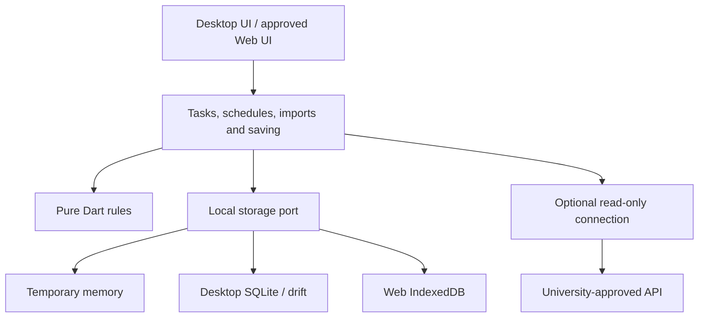

# ADR-005: User-chosen local saving, offline use and school-gated Web deployment

Later decision: [ADR-008](008-small-free-local-product.md) keeps shadcn_ui and narrows the first release to explicit saves, memory-only unsaved forms and ordinary local storage. Earlier saved-draft, encryption and broad Web/sync requirements below are historical where they conflict. Web/sync is now considered only for a school connection that needs it.

**Status:** Partially superseded by [ADR-007](007-general-purpose-local-planner.md). The school-permission gate for general product/Web deployment below was the user's earlier direction and no longer applies. Explicit saving, offline use, recovery, storage isolation and permissions for a particular school connection remain valid. Technical choices are proposed, not implemented.
**Date:** 2026-11-10; wording and application contracts clarified on 2026-11-11.
**Deciders at the time:** The maintainer decided product scope; a university would decide permissions relevant to a particular institutional deployment or connection.
**Historical refinement:** This extended [ADR-004](004-shadcn-web-direction.md) with a school deployment gate and IndexedDB as the offline Web candidate. ADR-007 now makes Web optional and removes the general school gate. The original reasoning is preserved below with that scope change.

## Current interpretation

Use [ADR-007](007-general-purpose-local-planner.md) for today's product scope and release rules. Personal plans and tasks work without a school or account. On first use, offer saving on this device or temporary use; keep business data in memory until an explicit saving choice. A general desktop or possible Web release needs no school approval. Apply the school-specific requirements below only to a school connection or use of its data. The local/offline and failure-handling safeguards still apply.

## Context and product references

The comparison uses public official information, not an audit of other products' internal systems. Cadence's choices are separate from those products' behavior.

| Product | Behavior described by its official source | Idea used in this proposal |
|---------|-------------------------------------------|----------------------------|
| [MyStudyLife](https://mystudylife.com/tour/) | Courses, assignments, exams, terms, holidays, offline use and cloud saving | Put academic and daily planning together without adding grades, AI or parent access |
| [Things](https://culturedcode.com/things/support/articles/2803586/) | Single-device use does not require Things Cloud; local data remains available offline | Make local tasks useful on their own and enable connections separately |
| [Obsidian security](https://obsidian.md/security) and [offline/sync guidance](https://obsidian.md/help/sync-notes) | Local files do not require an account; sync is a separate service | Keep a user-controlled local copy and portable exports; do not treat sync as backup or copy the plugin system |

## Options considered

| Option | Maintenance | Central data exposure | Offline use | Decision |
|--------|-------------|-----------------------|-------------|----------|
| Live school-timetable viewer only | Simple screens, strong API dependency | May avoid saving timetable data | Very limited | Possible temporary connection view, not the whole planner |
| Local planning with an optional read-only school connection | Moderate and incremental | No need to collect private plans centrally | Available after the user chooses saving | Recommended |
| Mandatory account, cloud database and sync | High: operations, authorization, recovery and conflicts | Central copies of private schedules | Still needs a separate offline design | Excluded from the initial product; later optional sync is [ADR-006](006-optional-multi-client-sync.md) |

## Historical product decision

- Desktop is the main product: Windows first, then validated macOS/Linux. No mobile app. Manual planning needs no school login.
- Public deployment of the Web planner needs explicit school permission, even without a school API. This is the user's project release condition, not a general legal claim about independent websites. Local development and fictional-data tests may continue.
- The existing static website is a separate concept presentation. This ADR does not turn it into a planner or authorize a new planner deployment.
- Confirm school authentication, timetable reads, local retention and export rights separately. Web-hosting permission does not grant API rights; desktop integration needs its own relevant permissions too.

Use the same page structure as [REDESIGN.md](../REDESIGN.md): Today, Week and Tasks are the main destinations; Courses and Weekly Review are reached from Week, and Settings from the menu. Teachers can use personal plans for teaching, meetings and research. A teacher role grants no access to students' private plans. Keep the independent academic-journal style and Flutter shadcn_ui direction.

## Two separate choices

### Save data on this device

| Mode | Behavior | Typical use |
|------|----------|-------------|
| Temporary use, the default before a choice | Business data stays in memory; no business database, saved drafts or automatic backup writes; refresh or exit may lose data | Trial or shared device |
| Save on this device | After explicit choice and a confirmed write, keep personal tasks, plans and settings for offline use after restart | Personal device |

Show temporary, saving, saved or failed status accurately. Explain language preferences and public application resources separately from business data. Temporary mode must not silently read an old private database to populate its screens.

A later startup may reuse the user's earlier local-saving choice. Explain that another person using the same OS account or browser profile may open the data. Switching to temporary use is not deletion: offer explicit keep-local-copy and clear-local-copy actions. Resolve current input and pending writes before switching; the detailed transition and interrupted-cleanup rules are in [APPLICATION.md](../APPLICATION.md#retention-mode-and-session-transitions).

School timetables default to temporary viewing. A separate save-for-offline action is available only for permitted fields and uses. General saving, drafts and private backups must not bypass school retention limits.

### Connect to the university

Default to disconnected. An offline-use control stops application-initiated school requests and rejects in-flight responses. Network recovery does not reconnect automatically. A manual refresh requires leaving offline mode and authenticating again if needed.

Offline mode controls application business requests; it does not claim to block the OS, browser, hosting platform or browser-update traffic. Required code, fonts and assets must not rely on runtime third-party requests.

Disconnect and delete-saved-timetable are separate actions. An allowed local copy may outlive a login session, but a retention expiry must follow the permission terms. A purely offline client cannot learn about a remote revocation immediately or enforce a tamper-proof expiry. If the university requires either guarantee, do not enable offline retention for that data.

## Data and technology boundaries

These are responsibility boundaries, not folders, tables or services to create now. The learner continues implementing core code through the current lessons.

- Desktop: use the proposed drift/SQLite adapter, a user-data directory, one writer, transactions and migration recovery. Enable and verify foreign keys. Never sync a live database file through a cloud drive to implement multi-device sync.
- Web: use the proposed IndexedDB adapter for structured business data, checking versions and clear generations in transactions. It does not provide SQL foreign keys, encryption or XSS protection. Use localStorage only for small non-sensitive preferences, never session tokens.
- Offline startup: cache an allowlist of public application resources through a tested Service Worker. Private timetables, API responses and authentication callbacks must not enter Cache Storage. Show offline-ready only after initial online preparation and testing. A never-opened Web app cannot promise an offline first launch.
- Limits and backup: retain the initial JSON limits of 1 MiB UTF-8 and 2,000 records, plus field-length, nesting and recurrence limits. Browsers may clear data; successful persistence permission is not a backup. Offer explicit export and test restore.
- Isolation: use a different origin for the real Web planner and the static website, HTTPS, a CSP fitted to the real build, and minimal third-party scripts. Verify actual responses and resources before deployment.

References: [IndexedDB transactions](https://developer.mozilla.org/en-US/docs/Web/API/IndexedDB_API), [browser storage and eviction](https://developer.mozilla.org/en-US/docs/Web/API/Storage_API/Storage_quotas_and_eviction_criteria), [Service Workers](https://developer.mozilla.org/en-US/docs/Web/API/Service_Worker_API/Using_Service_Workers) and [OWASP browser security](https://cheatsheetseries.owasp.org/cheatsheets/HTML5_Security_Cheat_Sheet.html).

### Ownership and lifecycle

| Data | Location and lifetime | Clear/export boundary |
|------|-----------------------|-----------------------|
| Personal tasks, plans and manual courses | Memory or chosen local database; retained until the user deletes them | Private backup may include them; timetable sharing excludes private tasks/notes |
| Raw school responses | Temporary processing; extract only permitted fields, never retain the entire response | Excluded from logs, backups and analytics |
| Permitted timetable snapshot and minimal source metadata | Separately chosen local retention, within the allowed term | Backup/share only if allowed; show last successful read time |
| Personal notes and adjustments to a source timetable | Separate from the source snapshot | Never uploaded to the university; source refresh cannot silently overwrite them |
| Editor drafts | Local-saving mode only; clear with their owning records | Full backup must state when drafts are included; temporary mode writes none |
| Undo-delete content | Initially short-lived memory in the current process | No backup or restart recovery; cannot undo a full clear |
| Automatic recovery copies | Desktop local-saving mode only; proposed limit of three copies and seven days, disclosed in the UI | Private content; included in application-managed clearing |
| User exports | User-selected location; no automatic upload | Plain JSON is marked private and unencrypted; application clear cannot retract external copies |
| Authentication secrets | Outside the schedule store and all exports; no long-term remember-login feature initially | Clear local sessions on logout and revoke through the protocol; explain if offline remote revocation remains incomplete |

Saving choice and clear-generation metadata are operational settings. Imports cannot enable saving, cancel cleanup or restore authentication. Enforce school retention and export limits in ordinary saves, drafts, backup and restore alike.

### Encryption and other protection

The current classroom prototype has no application-level encryption; ordinary JSON is plaintext. [DATA_PROTECTION.md](../DATA_PROTECTION.md) lists developer-side choices and acceptance. OS account locking and disk encryption may add protection on personal devices; shared-device users can choose temporary mode. A PIN that only hides the UI is not database encryption.

Protection against copied files needs tested encrypted storage/backups: maintained libraries, authenticated encryption, suitable key derivation and keys that are not stored as plaintext beside ciphertext. Define the consequences of forgotten passwords and lost keys. Encryption at rest does not stop XSS in an unlocked browser or a compromised OS. Do not claim an encrypted vault before key recovery and migration acceptance. See [OWASP cryptographic storage](https://cheatsheetseries.owasp.org/cheatsheets/Cryptographic_Storage_Cheat_Sheet.html).

## School connection and a possible intermediary

Prefer a school-approved direct client route. If the protocol needs server identity or secrets, add only the required intermediary; never bundle server secrets in the client. Protocols, CORS and API contracts are unconfirmed, so do not assume OAuth or SAML is available.

An intermediary may avoid a business-timetable database but still needs verified sessions and self-only access. Allow only fixed upstream routes and fields, never arbitrary proxy URLs or a client-supplied student ID as proof of access. Use appropriate no-cache responses. Exclude private response bodies and credentials from logs/error tracking, and limit rate, response size and request time.

Session and operating records may still need storage; do not claim a zero-data server. Article 11 of the university's authentication rules discusses access logs and an exception through the responsible contact. Confirm its scope and the minimum required log content with that contact; see the [official rules](https://web.sso.kyushu-u.ac.jp/documents/rules/ninsyou_youkou.pdf). Use fictional source data until approval.

## Clearing, concurrent use and failure

Before clearing local data, stop writes, reminders and requests; advance the clear generation; coordinate other instances; remove business data, drafts, application-managed backups and local credentials; then verify each result. An old tab or late response must not recreate cleared data. Database, filesystem, credential-store and cache cleanup cannot form one transaction. Track each result, offer retry and show incomplete cleanup until all required steps pass.

Web transactions check versions and clear generations. Migration and clear must close other connections or block writes with an explanation. A broadcast alone or advice to keep only one tab open is not protection. Do not release persistent mode on a platform that cannot coordinate it reliably.

Clear business data and public program caches through distinct scopes. Do not erase everything on a shared origin. Explain that removing offline resources affects later offline startup. Logical deletion does not promise physical disk erasure or removal of OS backups and user exports.

## Implementation and acceptance

1. Continue the small task-list, state, input and validation lessons; do not jump to a backend.
2. Complete desktop temporary/local choice, reliable saving, restart recovery, backup and clear before a small trial.
3. Build manual courses, Week, linked tasks and offline use while every school connection can remain disabled.
4. Add read-only school access and explicit timetable retention only after permission for those scopes. Do not write personal plans back to the university.
5. After Web-deployment permission, validate browser storage, multiple tabs, offline resources, clearing and privacy text before a limited launch.

Acceptance must cover temporary use with no business writes; failed-save input retention; offline restart/editing of saved data; unretained school data excluded from drafts/backups; rejection of old-account responses; no data resurrection by stale tabs after clear; private notes surviving source refresh; resource upgrades preserving data; recovery after browser eviction; and no credentials in logs, caches or exports. Do not deploy the Web planner without permission.

An old timetable may affect real plans. Show offline-copy status and last update time. Offline use cannot receive school changes or promise reminders after the Web app is closed; the school system remains the source of official information.

## Consequences and follow-up

The desktop local core can work without school approval, school-network availability or cloud services. Users must manage backups, and devices do not sync automatically. This desktop independence does not bypass the separate Web-deployment condition.

- [ ] Turn saving, clear and data-scope contracts into acceptance cases in their implementation lessons.
- [ ] Confirm APIs, fields, retention and export permission before connecting a real school source.
- [ ] Record Web approval scope, origin, maintainer and shutdown plan before release.
- [ ] Re-estimate the Web lessons. The earlier 8–16 estimate covered a smaller scope and does not guarantee full offline startup, concurrency or approval work.

This decision is a design record, not evidence of implemented security, installed dependencies or a working planner deployment.
